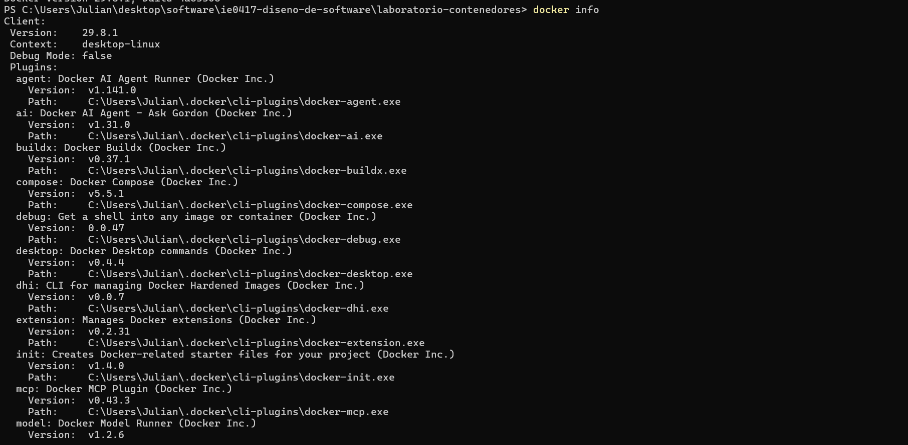

```markdown
# Parte 1: Verificación de instalación de Docker

## Versión de Docker instalada

Para verificar que Docker se encuentra instalado en el sistema, se ejecutó el siguiente comando:

```bash
docker --version
```

### Resultado obtenido

```text
Docker version 29.8.1, build 4a63305
```

Este comando permite consultar la versión de Docker instalada actualmente en el sistema.

## Sistema operativo utilizado

El laboratorio se realizó utilizando Windows.

## Información de Docker

Se ejecutó el siguiente comando:

```bash
docker info
```

Este comando muestra información detallada sobre la instalación y el estado actual de Docker. Entre la información disponible se encuentran los contenedores existentes, las imágenes almacenadas, la versión del servidor y diferentes características de la configuración del sistema.

### Resultado parcial obtenido

Client:
 Version:    29.8.1
 Context:    desktop-linux
 Debug Mode: false
 Plugins:
  agent: Docker AI Agent Runner (Docker Inc.)
    Version:  v1.141.0
    Path:     C:\Users\Julian\.docker\cli-plugins\docker-agent.exe
  ai: Docker AI Agent - Ask Gordon (Docker Inc.)
    Version:  v1.31.0
    Path:     C:\Users\Julian\.docker\cli-plugins\docker-ai.exe
  buildx: Docker Buildx (Docker Inc.)
    Version:  v0.37.1
    Path:     C:\Users\Julian\.docker\cli-plugins\docker-buildx.exe
  compose: Docker Compose (Docker Inc.)
    Version:  v5.5.1
    Path:     C:\Users\Julian\.docker\cli-plugins\docker-compose.exe
  debug: Get a shell into any image or container (Docker Inc.)
    Version:  0.0.47
    Path:     C:\Users\Julian\.docker\cli-plugins\docker-debug.exe
  desktop: Docker Desktop commands (Docker Inc.)
    Version:  v0.4.4
    Path:     C:\Users\Julian\.docker\cli-plugins\docker-desktop.exe
  dhi: CLI for managing Docker Hardened Images (Docker Inc.)
    Version:  v0.0.7
    Path:     C:\Users\Julian\.docker\cli-plugins\docker-dhi.exe
  extension: Manages Docker extensions (Docker Inc.)
    Version:  v0.2.31
    Path:     C:\Users\Julian\.docker\cli-plugins\docker-extension.exe
  init: Creates Docker-related starter files for your project (Docker Inc.)
    Version:  v1.4.0
    Path:     C:\Users\Julian\.docker\cli-plugins\docker-init.exe
  mcp: Docker MCP Plugin (Docker Inc.)
    Version:  v0.43.3
    Path:     C:\Users\Julian\.docker\cli-plugins\docker-mcp.exe
  model: Docker Model Runner (Docker Inc.)
    Version:  v1.2.6
    Path:     C:\Users\Julian\.docker\cli-plugins\docker-model.exe
  offload: Docker Offload (Docker Inc.)
    Version:  v0.6.33
    Path:     C:\Users\Julian\.docker\cli-plugins\docker-offload.exe
  pass: Docker Pass Secrets Manager Plugin (beta) (Docker Inc.)

## Ayuda de Docker

También se ejecutó el siguiente comando:

```bash
docker help
```

Este comando muestra los principales comandos disponibles en Docker y una breve descripción de la función de cada uno.

## Importancia de verificar la instalación

Verificar la instalación antes de continuar permite comprobar que Docker no solamente se encuentra instalado, sino que también está funcionando correctamente y puede comunicarse con el servicio encargado de administrar los contenedores. Esto permite detectar posibles problemas de configuración antes de continuar con las siguientes partes del laboratorio.

## Evidencia

A continuación se muestra evidencia de la ejecución de los comandos utilizados para verificar Docker:



## Preguntas de reflexión

### 1. ¿Qué diferencia hay entre instalar Docker y tener Docker ejecutándose correctamente?

Instalar Docker significa que el software y sus herramientas se encuentran disponibles en el sistema. Sin embargo, esto no garantiza que pueda utilizarse correctamente. Para ejecutar y administrar contenedores también es necesario que el servicio o daemon de Docker se encuentre activo y funcionando.

### 2. ¿Qué información útil muestra el comando `docker info`?

El comando `docker info` muestra información relacionada con el funcionamiento de Docker, como la cantidad de contenedores e imágenes disponibles, las versiones utilizadas, información del servidor y diferentes características de la configuración del sistema.

### 3. ¿Por qué Docker necesita un servicio o daemon ejecutándose en segundo plano?

Docker necesita un daemon porque este es el encargado de realizar las operaciones relacionadas con los contenedores y las imágenes. Cuando se ejecuta un comando desde la terminal, el cliente de Docker se comunica con este servicio para solicitar operaciones como crear, ejecutar, detener o eliminar contenedores.
```

Ahí sí están literalmente los `#`, `##`, `###`, los bloques de código y la referencia a la imagen.

Solo reemplaza los dos textos entre corchetes con tus resultados reales. A partir de ahora, cuando te dé contenido para un `.md`, te lo doy de esta forma literal para que sea copiar → pegar → guardar.