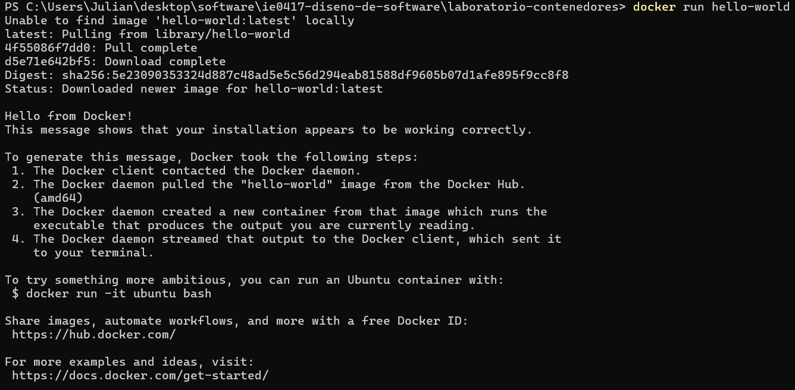
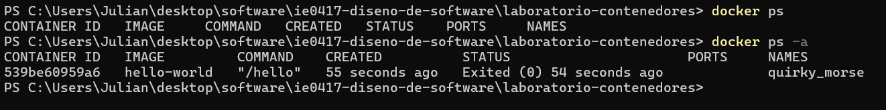

# Parte 2: Primer contenedor

## Ejecución del primer contenedor

Para ejecutar el primer contenedor se utilizó el siguiente comando:

```bash
docker run hello-world
```

Este comando crea y ejecuta un contenedor a partir de la imagen `hello-world`.

### Resultado obtenido

Al ejecutar el comando, Docker utilizó la imagen `hello-world` y ejecutó el contenedor correctamente. El contenedor mostró el mensaje de confirmación de Docker y posteriormente terminó su ejecución.

Si la imagen no se encontraba previamente en el sistema, Docker la descargó automáticamente antes de crear el contenedor.

## Contenedores en ejecución

Se ejecutó el siguiente comando:

```bash
docker ps
```

Este comando muestra los contenedores que se encuentran actualmente en ejecución.

### Resultado obtenido

El contenedor `hello-world` no apareció en la lista debido a que su ejecución ya había finalizado.

## Todos los contenedores

Posteriormente se ejecutó:

```bash
docker ps -a
```

La opción `-a` permite visualizar todos los contenedores existentes, incluyendo aquellos que ya terminaron su ejecución.

### Resultado obtenido

En este caso sí fue posible observar el contenedor creado a partir de la imagen `hello-world`, aunque ya se encontraba detenido.

## Evidencias

### Ejecución de hello-world



### Consulta de contenedores



## Preguntas de reflexión

### 1. ¿Qué es la imagen `hello-world`?

La imagen `hello-world` es una imagen sencilla utilizada para verificar que Docker puede obtener una imagen, crear un contenedor a partir de ella y ejecutarlo correctamente.

### 2. ¿El contenedor quedó ejecutándose después de imprimir el mensaje?

No. Después de mostrar el mensaje correspondiente, el programa terminó su ejecución y el contenedor quedó detenido.

### 3. ¿Por qué aparece en `docker ps -a` pero no necesariamente en `docker ps`?

Porque `docker ps` muestra únicamente los contenedores que se encuentran actualmente en ejecución, mientras que `docker ps -a` muestra todos los contenedores, incluyendo aquellos cuya ejecución ya terminó.

### 4. ¿Qué demuestra este primer ejemplo sobre Docker?

Este ejemplo demuestra el flujo básico de Docker: utilizar una imagen para crear un contenedor, ejecutar el programa contenido en ella y posteriormente poder consultar el estado del contenedor.
