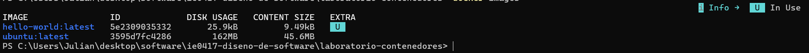
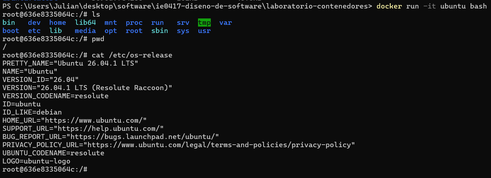
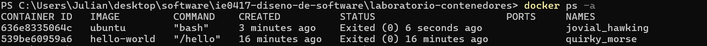
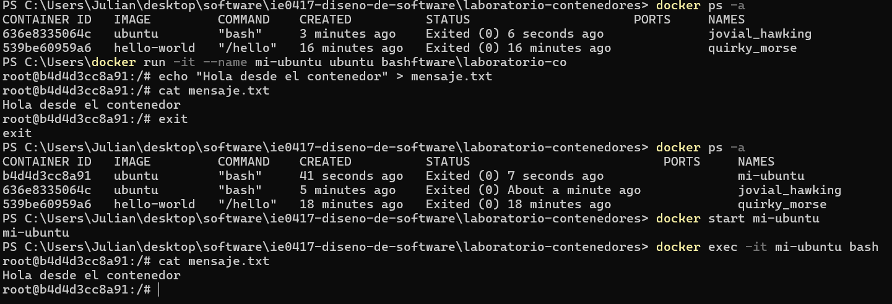

# Parte 3: Imágenes y contenedores

## Descarga de la imagen Ubuntu

Se ejecutó el siguiente comando:

```bash
docker pull ubuntu
```

El comando `docker pull` permite descargar una imagen desde un registro de imágenes de Docker. En este caso se descargó la imagen de Ubuntu.

## Consulta de imágenes disponibles

Posteriormente se ejecutó:

```bash
docker images
```

Este comando muestra las imágenes que se encuentran almacenadas localmente en el sistema.

### Evidencia



## Ejecución de un contenedor interactivo

Para crear un contenedor a partir de la imagen de Ubuntu y acceder a una terminal dentro de este se utilizó:

```bash
docker run -it ubuntu bash
```

La opción `-it` permite utilizar el contenedor de forma interactiva mediante una terminal.

Dentro del contenedor se ejecutaron los siguientes comandos:

```bash
ls
```

El comando `ls` permitió observar los archivos y directorios disponibles dentro del contenedor.

También se ejecutó:

```bash
pwd
```

Este comando mostró el directorio de trabajo actual dentro del contenedor.

Finalmente se utilizó:

```bash
cat /etc/os-release
```

Este comando permitió consultar información sobre el sistema Ubuntu disponible dentro del contenedor.

### Evidencia



## Salida del contenedor

Para salir del contenedor se utilizó:

```bash
exit
```

Después de salir se ejecutó:

```bash
docker ps -a
```

El contenedor apareció en la lista, pero ya no se encontraba en ejecución.

### Evidencia



## Preguntas de reflexión sobre imágenes y contenedores

### 1. ¿La imagen Ubuntu es lo mismo que una máquina virtual Ubuntu?

No. Una imagen de Docker contiene los archivos y componentes necesarios para crear contenedores, pero no representa una máquina virtual completa con su propio sistema operativo y kernel.

### 2. ¿Por qué el contenedor puede parecer un sistema Linux si no es una máquina virtual completa?

Porque el contenedor dispone de archivos, programas y herramientas propias del entorno Linux de la imagen utilizada, aunque no incluye un kernel independiente como una máquina virtual.

### 3. ¿Qué significa que el contenedor comparta el kernel con el host?

Significa que el contenedor utiliza el kernel proporcionado por el sistema anfitrión en lugar de ejecutar uno completamente independiente.

### 4. ¿Qué diferencia hay entre una imagen descargada y un contenedor creado?

Una imagen funciona como una plantilla que contiene los elementos necesarios para ejecutar una aplicación. Un contenedor es una instancia creada a partir de esa imagen que puede ejecutarse, detenerse y modificarse durante su ciclo de vida.

# Administración de contenedores

## Creación de un contenedor con nombre

Se ejecutó:

```bash
docker run -it --name mi-ubuntu ubuntu bash
```

La opción `--name` permite asignar un nombre específico al contenedor. En este caso se utilizó el nombre `mi-ubuntu`.

## Creación de un archivo dentro del contenedor

Dentro del contenedor se ejecutó:

```bash
echo "Hola desde el contenedor" > mensaje.txt
```

Este comando creó el archivo `mensaje.txt` con un mensaje de prueba.

Para verificar su contenido se utilizó:

```bash
cat mensaje.txt
```

El archivo mostró correctamente el mensaje almacenado.

## Reinicio del contenedor

Después de salir del contenedor se utilizó:

```bash
docker start mi-ubuntu
```

Este comando inició nuevamente el mismo contenedor existente.

Posteriormente se ingresó al contenedor mediante:

```bash
docker exec -it mi-ubuntu bash
```

El comando `docker exec` permite ejecutar un comando dentro de un contenedor que ya se encuentra en ejecución. En este caso se utilizó para abrir nuevamente una terminal Bash.

Dentro del contenedor se verificó otra vez el archivo:

```bash
cat mensaje.txt
```

El archivo continuaba existiendo después de haber detenido y vuelto a iniciar el contenedor.

### Evidencia



## Detención y eliminación del contenedor

Para detener el contenedor se utilizó:

```bash
docker stop mi-ubuntu
```

Posteriormente se eliminó mediante:

```bash
docker rm mi-ubuntu
```

Finalmente se verificó la lista de contenedores:

```bash
docker ps -a
```

Detener un contenedor conserva el contenedor y su información, mientras que eliminarlo elimina esa instancia.

## Preguntas de reflexión sobre administración de contenedores

### 1. ¿Qué ventaja tiene asignar nombres a los contenedores?

Asignar un nombre permite identificar y administrar los contenedores de una forma más sencilla que utilizando solamente su identificador.

### 2. ¿Qué diferencia hay entre crear un contenedor nuevo y reiniciar uno existente?

Crear un contenedor nuevo genera una nueva instancia a partir de una imagen. Reiniciar un contenedor existente vuelve a ejecutar la misma instancia, conservando los cambios realizados dentro de ella mientras no haya sido eliminada.

### 3. ¿Qué sucede con los datos creados dentro de un contenedor si este se elimina?

Los datos almacenados únicamente dentro del sistema de archivos del contenedor se pierden cuando este se elimina, a menos que se hayan almacenado mediante algún mecanismo de persistencia como un volumen.

### 4. ¿Por qué se dice que los contenedores son desechables?

Porque pueden crearse y eliminarse fácilmente a partir de imágenes. En lugar de depender permanentemente de una instancia específica, normalmente se busca poder reemplazarla por otra creada a partir de la misma imagen.
