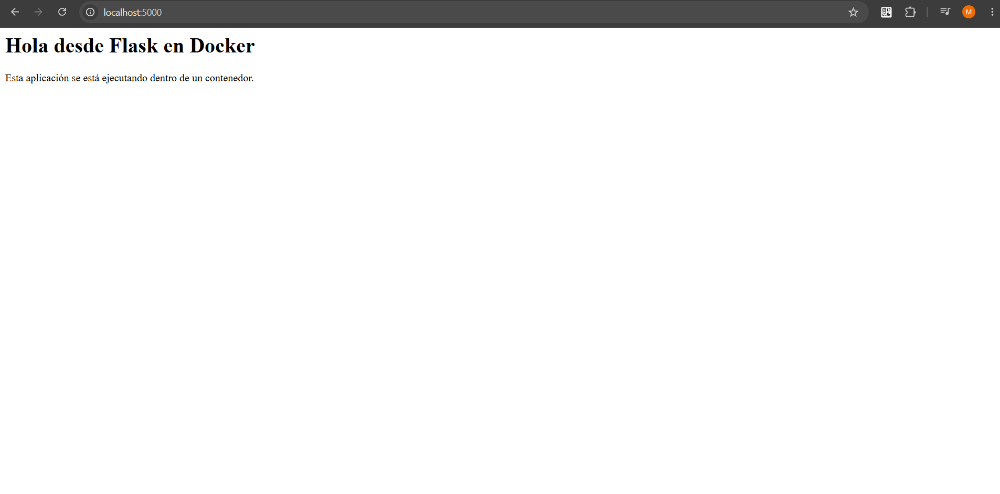
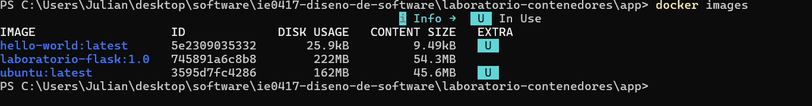
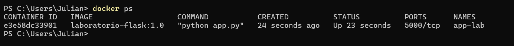

# Parte 4: Aplicación Flask y Dockerfile

## Aplicación desarrollada

Se creó una aplicación web sencilla utilizando Flask.

La aplicación contiene dos rutas principales:

### Ruta principal

```text
/
```

Esta ruta muestra un mensaje en formato HTML. El mensaje puede obtenerse desde una variable de entorno llamada `MENSAJE`. Si esta variable no se encuentra definida, se utiliza el mensaje predeterminado:

```text
Hola desde Flask en Docker
```

### Ruta de información

```text
/info
```

Esta ruta devuelve información sobre la aplicación en formato similar a JSON:

```json
{
    "app": "Laboratorio de contenedores",
    "curso": "IE0417",
    "tema": "Docker"
}
```

## Dependencia utilizada

La aplicación utiliza Flask como dependencia.

Esta dependencia se especificó en el archivo:

```text
requirements.txt
```

con el siguiente contenido:

```text
flask
```

El archivo `requirements.txt` permite indicar las dependencias de Python necesarias para ejecutar la aplicación.

## Ejecución local

Para instalar las dependencias se utilizó:

```bash
python -m pip install -r requirements.txt
```

Posteriormente se ejecutó la aplicación:

```bash
python app.py
```

La aplicación quedó disponible en:

```text
http://localhost:5000
```

También se comprobó la ruta:

```text
http://localhost:5000/info
```

### Evidencia



## Uso de `0.0.0.0`

La aplicación se ejecuta mediante:

```python
app.run(host="0.0.0.0", port=5000)
```

Se utiliza `0.0.0.0` para que la aplicación escuche conexiones en todas las interfaces de red disponibles dentro del contenedor.

Si se utilizara únicamente `localhost`, la aplicación podría quedar accesible solamente desde el propio contenedor, dificultando el acceso desde la máquina anfitriona.

# Construcción de la imagen con Dockerfile

Para crear una imagen personalizada se utilizó el siguiente Dockerfile:

```dockerfile
FROM python:3.11-slim

WORKDIR /app

COPY requirements.txt .

RUN pip install --no-cache-dir -r requirements.txt

COPY . .

EXPOSE 5000

CMD ["python", "app.py"]
```

## Explicación de las instrucciones del Dockerfile

### `FROM`

```dockerfile
FROM python:3.11-slim
```

Indica la imagen base a partir de la cual se construirá la nueva imagen. En este caso se utiliza una imagen de Python 3.11 en su versión `slim`.

### `WORKDIR`

```dockerfile
WORKDIR /app
```

Establece `/app` como el directorio de trabajo dentro de la imagen.

Los comandos posteriores se ejecutarán tomando este directorio como referencia.

### `COPY`

```dockerfile
COPY requirements.txt .
```

Copia el archivo `requirements.txt` desde la máquina anfitriona hacia el directorio de trabajo de la imagen.

Posteriormente también se utiliza:

```dockerfile
COPY . .
```

para copiar el resto de los archivos de la aplicación.

### `RUN`

```dockerfile
RUN pip install --no-cache-dir -r requirements.txt
```

Ejecuta un comando durante el proceso de construcción de la imagen.

En este caso instala las dependencias de Python indicadas en `requirements.txt`.

### `EXPOSE`

```dockerfile
EXPOSE 5000
```

Indica que la aplicación utiliza el puerto 5000 dentro del contenedor.

### `CMD`

```dockerfile
CMD ["python", "app.py"]
```

Define el comando predeterminado que se ejecutará cuando se inicie un contenedor creado a partir de esta imagen.

## Construcción de la imagen

La imagen se construyó mediante:

```bash
docker build -t laboratorio-flask:1.0 .
```

El comando `docker build` utiliza el Dockerfile del directorio actual para construir una imagen.

La opción:

```text
-t laboratorio-flask:1.0
```

permite asignar un nombre y una etiqueta a la imagen.

En este caso:

```text
laboratorio-flask
```

es el nombre de la imagen y:

```text
1.0
```

es su etiqueta o versión.

## Consulta de imágenes

Después de construir la imagen se ejecutó:

```bash
docker images
```

Este comando permitió verificar que la imagen `laboratorio-flask:1.0` se encontraba disponible localmente.

### Evidencia



## Ejecución del contenedor

Se ejecutó:

```bash
docker run --name app-lab laboratorio-flask:1.0
```

La opción `--name` permitió asignar al contenedor el nombre:

```text
app-lab
```

En otra terminal se verificó su ejecución mediante:

```bash
docker ps
```

### Evidencia



Posteriormente se detuvo y eliminó el contenedor:

```bash
docker stop app-lab
docker rm app-lab
```

## Diferencia entre el nombre de la imagen y el nombre del contenedor

`laboratorio-flask:1.0` identifica la imagen utilizada como plantilla para crear contenedores.

`app-lab`, en cambio, identifica una instancia específica creada a partir de esa imagen.

Una misma imagen puede utilizarse para crear varios contenedores diferentes.

## Preguntas de reflexión

### 1. ¿Qué hace Flask en esta aplicación?

Flask proporciona las herramientas necesarias para crear el servidor web y definir las rutas de la aplicación. En este caso permite responder solicitudes dirigidas a `/` y `/info`.

### 2. ¿Para qué sirve el archivo `requirements.txt`?

Permite indicar las dependencias de Python necesarias para ejecutar la aplicación. Esto facilita instalar automáticamente las mismas dependencias en diferentes sistemas o durante la construcción de una imagen Docker.

### 3. ¿Por qué una aplicación dentro de un contenedor debe escuchar en `0.0.0.0`?

Porque de esta manera la aplicación acepta conexiones provenientes de otras interfaces de red y no únicamente conexiones originadas dentro del propio contenedor.

### 4. ¿Qué diferencia hay entre ejecutar la aplicación localmente y ejecutarla dentro de Docker?

Al ejecutarla localmente, la aplicación depende directamente de la configuración, versión de Python y paquetes instalados en la máquina anfitriona.

Al ejecutarla dentro de Docker, estas dependencias y configuraciones se encuentran definidas dentro de la imagen, lo que permite obtener un entorno más consistente.

### 5. ¿Qué es una imagen base?

Es una imagen existente que se utiliza como punto de partida para construir una nueva imagen. En este caso se utilizó `python:3.11-slim`.

### 6. ¿Por qué se usa una imagen `slim`?

Porque proporciona los componentes necesarios para utilizar Python, pero con un tamaño menor que una imagen más completa.

### 7. ¿Por qué se copian primero las dependencias y luego el resto del código?

Esto permite aprovechar mejor el sistema de capas y caché de Docker. Si las dependencias no cambian, Docker puede reutilizar la capa donde fueron instaladas aunque se modifique el código de la aplicación.

### 8. ¿Qué diferencia hay entre `RUN` y `CMD`?

`RUN` ejecuta comandos durante la construcción de la imagen y sus resultados quedan incorporados en ella.

`CMD` define el comando que se ejecutará posteriormente cuando se inicie un contenedor a partir de la imagen.

### 9. ¿Qué pasaría si se elimina la imagen pero no el Dockerfile?

La imagen podría volver a construirse utilizando el Dockerfile y los archivos necesarios de la aplicación.
