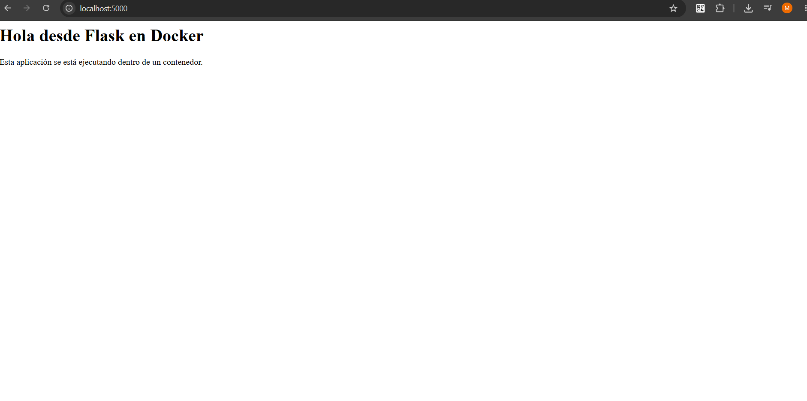
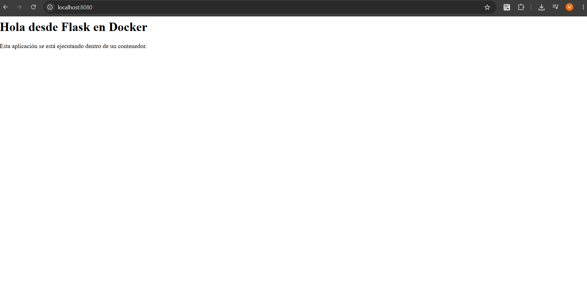
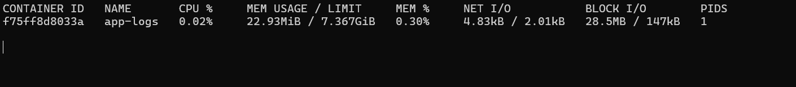
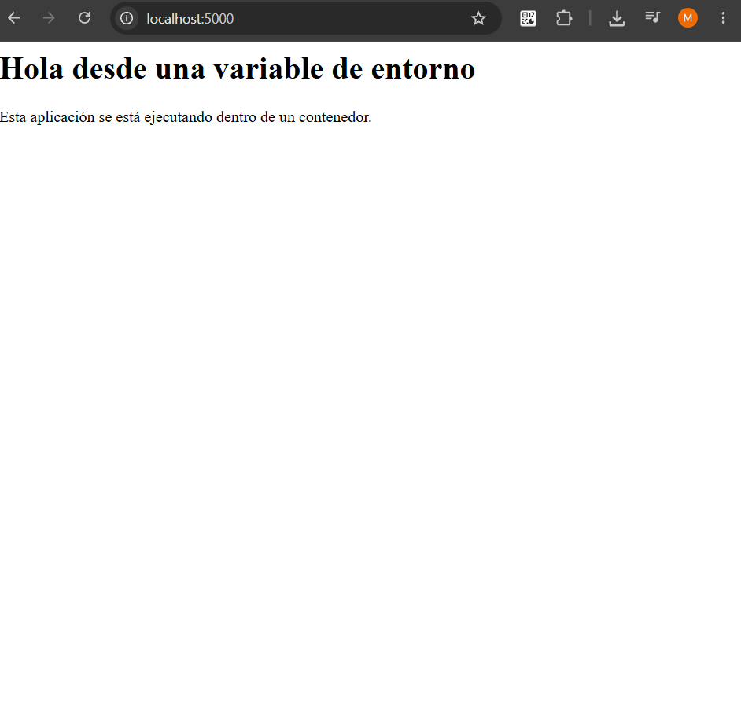
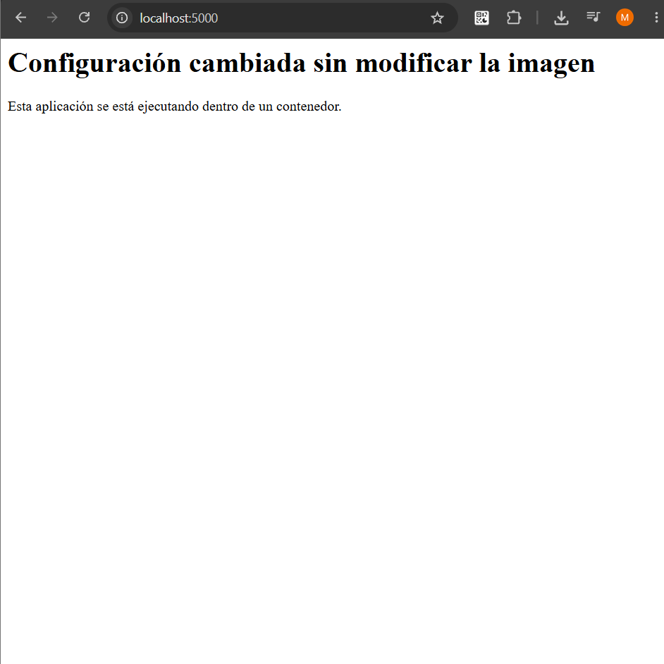

# Parte 5: Puertos, logs y variables de entorno

# Publicación de puertos

## Ejecución utilizando el puerto 5000

Se ejecutó la aplicación publicando el puerto 5000 mediante el siguiente comando:

```bash
docker run --name app-puertos -p 5000:5000 laboratorio-flask:1.0
```

La opción:

```text
-p 5000:5000
```

realiza un mapeo entre un puerto de la máquina anfitriona y un puerto del contenedor.

En este caso, el primer `5000` corresponde al puerto de la máquina anfitriona y el segundo `5000` corresponde al puerto utilizado por la aplicación dentro del contenedor.

La aplicación pudo accederse desde:

```text
http://localhost:5000
```

También se verificó la ruta:

```text
http://localhost:5000/info
```

### Evidencia



## Ejecución utilizando el puerto 8080

Posteriormente se ejecutó otro contenedor utilizando:

```bash
docker run --name app-puertos-2 -p 8080:5000 laboratorio-flask:1.0
```

En este caso, la aplicación continúa utilizando el puerto `5000` dentro del contenedor, pero se puede acceder a ella mediante el puerto `8080` de la máquina anfitriona.

La aplicación se abrió mediante:

```text
http://localhost:8080
```

### Evidencia



## Diferencia entre el puerto del host y el puerto del contenedor

El puerto del host corresponde al puerto utilizado en la máquina anfitriona para acceder al servicio.

El puerto del contenedor corresponde al puerto en el cual la aplicación escucha dentro del entorno del contenedor.

En la expresión:

```text
-p 8080:5000
```

el puerto `8080` pertenece al host y el puerto `5000` pertenece al contenedor.

## Preguntas de reflexión sobre puertos

### 1. ¿Por qué no basta con que la aplicación escuche en el puerto 5000 dentro del contenedor?

Porque el contenedor posee su propio entorno de red. Aunque la aplicación escuche en el puerto 5000 dentro del contenedor, es necesario publicar ese puerto para poder acceder a la aplicación desde la máquina anfitriona.

### 2. ¿Qué función cumple el mapeo de puertos?

El mapeo permite asociar un puerto de la máquina anfitriona con un puerto del contenedor, haciendo posible acceder desde el host a un servicio ejecutado dentro del contenedor.

### 3. ¿Cuál es la diferencia entre el puerto del host y el puerto del contenedor?

El puerto del host es el que se utiliza desde la máquina anfitriona. El puerto del contenedor es el que utiliza internamente la aplicación.

### 4. ¿Qué pasaría si dos contenedores intentan usar el mismo puerto del host?

No podrían utilizar simultáneamente el mismo puerto del host, ya que este no puede asignarse a dos contenedores al mismo tiempo. Sería necesario utilizar diferentes puertos del host.

# Logs e inspección

## Ejecución en segundo plano

Para ejecutar la aplicación en segundo plano se utilizó:

```bash
docker run -d --name app-logs -p 5000:5000 laboratorio-flask:1.0
```

La opción `-d` permite ejecutar el contenedor en modo detached, es decir, en segundo plano.

## Consulta de logs

Se ejecutó:

```bash
docker logs app-logs
```

Este comando muestra los mensajes generados por el contenedor desde el inicio de su ejecución.

Posteriormente se utilizó:

```bash
docker logs -f app-logs
```

La opción `-f` permite seguir los logs en tiempo real.

Al visitar:

```text
http://localhost:5000
```

y:

```text
http://localhost:5000/info
```

fue posible observar nuevas solicitudes en los logs de la aplicación.

## Inspección del contenedor

Se ejecutó:

```bash
docker inspect app-logs
```

Este comando muestra información detallada sobre el contenedor, incluyendo su configuración, red, estado, almacenamiento y otros parámetros internos.

## Uso de recursos

También se ejecutó:

```bash
docker stats
```

Este comando permite observar en tiempo real el consumo de recursos de los contenedores, como CPU, memoria y uso de red.

### Evidencia



## Preguntas de reflexión sobre logs e inspección

### 1. ¿Por qué los logs son importantes al trabajar con contenedores?

Los logs permiten observar lo que ocurre durante la ejecución de una aplicación y ayudan a identificar errores, solicitudes recibidas y otros eventos importantes.

### 2. ¿Qué diferencia hay entre ver logs históricos y logs en tiempo real?

Los logs históricos muestran mensajes generados anteriormente, mientras que los logs en tiempo real se actualizan conforme el contenedor genera nueva información.

### 3. ¿Qué información útil se puede obtener con `docker inspect`?

Permite obtener información detallada sobre la configuración del contenedor, su estado, red, variables de entorno, volúmenes y otros parámetros internos.

### 4. ¿Por qué es importante observar el consumo de recursos?

Porque permite conocer cuánto CPU, memoria y otros recursos está utilizando un contenedor, lo que ayuda a detectar problemas de rendimiento o consumo excesivo.

# Variables de entorno

## Primera ejecución

Se ejecutó la aplicación utilizando una variable de entorno mediante:

```bash
docker run --name app-env -p 5000:5000 -e MENSAJE="Hola desde una variable de entorno" laboratorio-flask:1.0
```

La opción `-e` permite definir una variable de entorno dentro del contenedor.

En este caso se definió:

```text
MENSAJE="Hola desde una variable de entorno"
```

La aplicación utiliza esta variable para modificar el mensaje mostrado en la página principal.

### Evidencia



## Segunda ejecución

Posteriormente se ejecutó nuevamente la misma imagen utilizando otro valor:

```bash
docker run --name app-env-2 -p 5000:5000 -e MENSAJE="Configuración cambiada sin modificar la imagen" laboratorio-flask:1.0
```

La página principal mostró el nuevo mensaje sin necesidad de modificar el código ni reconstruir la imagen.

### Evidencia



## Uso de la opción `-e`

La opción `-e` permite enviar variables de entorno al contenedor en el momento de su ejecución.

Esto permite modificar ciertos parámetros de configuración sin realizar cambios directamente en el código de la aplicación.

## Razón por la que no fue necesario reconstruir la imagen

No fue necesario reconstruir la imagen porque el código de la aplicación ya estaba preparado para obtener el contenido de la variable de entorno `MENSAJE`.

La configuración se proporcionó en el momento de crear el contenedor utilizando `docker run`.

## Preguntas de reflexión sobre variables de entorno

### 1. ¿Por qué es útil configurar aplicaciones mediante variables de entorno?

Porque permite modificar la configuración de una aplicación sin cambiar directamente su código ni reconstruir la imagen.

### 2. ¿Qué tipo de información podría configurarse así?

Se pueden configurar parámetros como puertos, modos de ejecución, direcciones de otros servicios y diferentes valores utilizados por la aplicación.

### 3. ¿Por qué no es buena práctica guardar contraseñas directamente dentro del código?

Porque las contraseñas quedarían almacenadas junto con el código y podrían quedar expuestas a personas que tengan acceso al repositorio o a los archivos de la aplicación.

### 4. ¿Qué ventaja tiene usar la misma imagen con diferentes configuraciones?

Permite reutilizar una única imagen para diferentes situaciones o entornos, cambiando únicamente la configuración utilizada cuando se crea cada contenedor.
