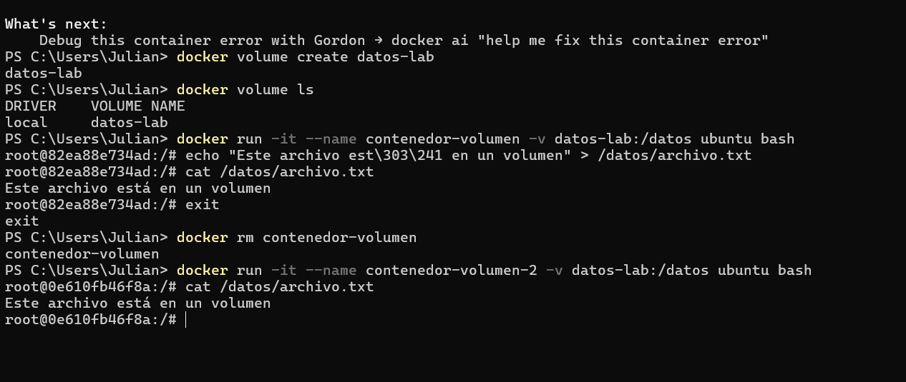
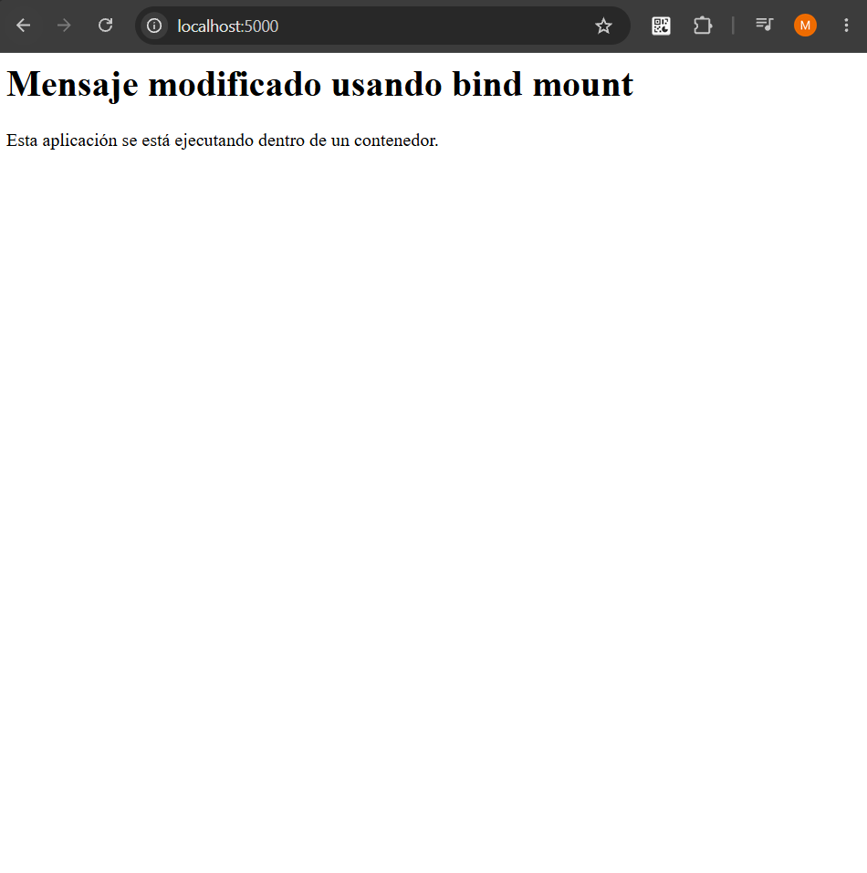

# Parte 6: Volúmenes y bind mounts

# Persistencia con volúmenes

## Creación del volumen

Se creó un volumen llamado `datos-lab` mediante:

```bash
docker volume create datos-lab
```

Los volúmenes permiten almacenar información fuera del ciclo de vida de un contenedor.

Posteriormente se consultaron los volúmenes disponibles mediante:

```bash
docker volume ls
```

## Montaje del volumen

Se creó un contenedor Ubuntu utilizando el volumen mediante:

```bash
docker run -it --name contenedor-volumen -v datos-lab:/datos ubuntu bash
```

La expresión:

```text
datos-lab:/datos
```

indica que el volumen llamado `datos-lab` se monta en el directorio `/datos` dentro del contenedor.

## Creación de información persistente

Dentro del contenedor se ejecutó:

```bash
echo "Este archivo está en un volumen" > /datos/archivo.txt
```

Posteriormente se verificó el contenido mediante:

```bash
cat /datos/archivo.txt
```

Después se salió del contenedor y se eliminó mediante:

```bash
docker rm contenedor-volumen
```

## Verificación de persistencia

Se creó un segundo contenedor utilizando el mismo volumen:

```bash
docker run -it --name contenedor-volumen-2 -v datos-lab:/datos ubuntu bash
```

Dentro del nuevo contenedor se ejecutó:

```bash
cat /datos/archivo.txt
```

El archivo continuaba disponible aunque el contenedor original había sido eliminado.

Esto demuestra que los datos almacenados en un volumen no dependen del ciclo de vida de un contenedor específico.

### Evidencia



## Inspección del volumen

Se ejecutó:

```bash
docker volume inspect datos-lab
```

Este comando permite consultar información detallada del volumen, incluyendo su nombre, controlador y ubicación administrada por Docker.

## Preguntas de reflexión sobre volúmenes

### 1. ¿Qué problema resuelven los volúmenes?

Permiten conservar información aunque los contenedores que utilizan esos datos sean detenidos o eliminados.

### 2. ¿El volumen pertenece a un contenedor específico?

No. Un volumen es administrado de manera independiente por Docker y puede ser utilizado por diferentes contenedores.

### 3. ¿Qué diferencia hay entre eliminar un contenedor y eliminar un volumen?

Eliminar un contenedor elimina esa instancia específica, mientras que eliminar un volumen elimina los datos persistentes almacenados en él.

### 4. ¿Para qué casos reales se usarían volúmenes?

Se pueden utilizar para almacenar información que debe permanecer disponible, como datos de bases de datos, archivos generados por aplicaciones o información que debe conservarse aunque un contenedor sea reemplazado.

# Bind mounts

## Montaje de una carpeta local

Desde la carpeta `app` se ejecutó:

```bash
docker run --name app-bind -p 5000:5000 -v ${PWD}:/app laboratorio-flask:1.0
```

En este caso, la carpeta local de la aplicación se montó directamente en `/app` dentro del contenedor.

A diferencia de un volumen administrado por Docker, un bind mount utiliza directamente una carpeta existente en la máquina anfitriona.

## Modificación del código local

Se modificó el archivo `app.py` en la máquina anfitriona.

Posteriormente se creó otro contenedor utilizando nuevamente el bind mount:

```bash
docker run --name app-bind-2 -p 5000:5000 -v ${PWD}:/app laboratorio-flask:1.0
```

Al acceder nuevamente a la aplicación, se observó el cambio realizado en el archivo local sin necesidad de reconstruir la imagen.

### Evidencia



## Diferencia entre volumen y bind mount

En:

```text
datos-lab:/datos
```

`datos-lab` es un volumen administrado por Docker.

En:

```text
${PWD}:/app
```

se utiliza directamente una carpeta del sistema anfitrión como contenido del directorio `/app` del contenedor.

## Utilidad durante el desarrollo

Los bind mounts son útiles durante el desarrollo porque permiten trabajar directamente con los archivos locales y reflejar esos cambios dentro del contenedor sin tener que reconstruir la imagen después de cada modificación.

## Preguntas de reflexión sobre bind mounts

### 1. ¿Qué diferencia hay entre un volumen y un bind mount?

Un volumen es administrado directamente por Docker, mientras que un bind mount utiliza una carpeta o archivo específico de la máquina anfitriona.

### 2. ¿Cuál parece más conveniente para desarrollo?

El bind mount resulta especialmente conveniente durante el desarrollo porque permite editar los archivos directamente desde la máquina anfitriona y utilizar esos mismos archivos dentro del contenedor.

### 3. ¿Cuál parece más conveniente para datos persistentes de una aplicación?

Los volúmenes suelen ser más convenientes para almacenar datos persistentes porque Docker administra su ubicación y ciclo de vida.

### 4. ¿Qué riesgos podría tener montar carpetas del host dentro del contenedor?

El contenedor obtiene acceso a archivos de la máquina anfitriona. Dependiendo de los permisos utilizados, una aplicación podría modificar o eliminar archivos locales accidentalmente.
