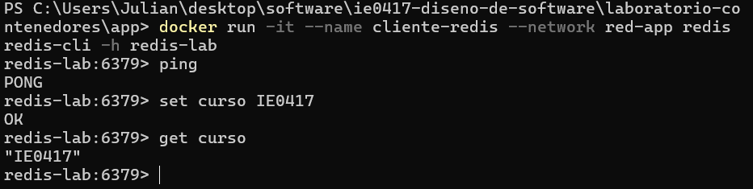

````markdown
# Parte 7: Redes de Docker

# Comunicación entre contenedores

## Creación de una red personalizada

Se creó una red de Docker mediante el siguiente comando:

```bash
docker network create red-lab
```

Una red de Docker permite que diferentes contenedores puedan comunicarse entre sí.

Posteriormente se consultaron las redes disponibles mediante:

```bash
docker network ls
```

## Ejecución del servidor web

Se creó un contenedor utilizando Nginx:

```bash
docker run -d --name servidor-web --network red-lab nginx
```

La opción:

```text
--network red-lab
```

conecta el contenedor a la red personalizada creada anteriormente.

El contenedor recibió el nombre:

```text
servidor-web
```

## Ejecución del cliente

Se creó un segundo contenedor utilizando Ubuntu:

```bash
docker run -it --name cliente --network red-lab ubuntu bash
```

Este contenedor también fue conectado a la red `red-lab`.

Dentro del contenedor se instalaron las herramientas necesarias para realizar una solicitud HTTP:

```bash
apt update
apt install -y curl
```

Posteriormente se ejecutó:

```bash
curl http://servidor-web
```

El comando permitió obtener la página proporcionada por el servidor Nginx.

### Evidencia


## Uso del nombre del contenedor

Fue posible utilizar:

```text
servidor-web
```

en lugar de una dirección IP porque ambos contenedores estaban conectados a la misma red personalizada de Docker.

Docker puede resolver los nombres de los contenedores dentro de estas redes, facilitando la comunicación entre servicios.

## Preguntas de reflexión sobre redes

### 1. ¿Por qué los contenedores necesitan redes?

Las redes permiten que los contenedores puedan comunicarse entre sí y con otros sistemas cuando las aplicaciones necesitan intercambiar información.

### 2. ¿Qué ventaja tiene usar nombres de contenedor en lugar de direcciones IP?

Los nombres son más fáciles de identificar y permiten evitar depender directamente de direcciones IP que pueden cambiar cuando los contenedores son recreados.

### 3. ¿Qué diferencia hay entre publicar un puerto hacia el host y comunicarse dentro de una red Docker?

Publicar un puerto permite que la máquina anfitriona acceda a un servicio dentro de un contenedor.

Una red Docker permite que diferentes contenedores se comuniquen directamente entre sí sin que necesariamente sea necesario publicar esos servicios hacia el host.

### 4. ¿Qué ejemplos reales podrían usar una red Docker?

Una aplicación web podría utilizar una red Docker para comunicarse con una base de datos, un sistema de caché u otros servicios ejecutados en contenedores separados.

# Comunicación entre servicios

## Creación de la red

Para el segundo ejemplo se creó una red llamada `red-app`:

```bash
docker network create red-app
```

## Ejecución del servidor Redis

Se ejecutó un contenedor de Redis mediante:

```bash
docker run -d --name redis-lab --network red-app redis
```

En este ejemplo, Redis funciona como un servicio independiente al cual otros contenedores pueden conectarse.

El nombre del contenedor servidor es:

```text
redis-lab
```

## Ejecución del cliente Redis

Se creó un segundo contenedor conectado a la misma red:

```bash
docker run -it --name cliente-redis --network red-app redis redis-cli -h redis-lab
```

El cliente se conectó al servidor utilizando el nombre:

```text
redis-lab
```

## Prueba de conexión

Dentro del cliente Redis se ejecutó:

```text
ping
```

El servidor respondió:

```text
PONG
```

Esta respuesta confirmó que existía comunicación entre los dos contenedores.

También se almacenó un valor mediante:

```text
set curso IE0417
```

y se recuperó utilizando:

```text
get curso
```

El resultado obtenido fue:

```text
"IE0417"
```

### Evidencia



## Enseñanza del ejemplo

Este ejemplo demuestra que una aplicación puede estar dividida en diferentes servicios ejecutados en contenedores separados y que estos pueden comunicarse mediante una red de Docker.

Un contenedor podría ejecutar la aplicación principal mientras otro proporciona servicios adicionales como una base de datos o un sistema de almacenamiento temporal.

## Preguntas de reflexión sobre comunicación entre servicios

### 1. ¿Por qué una aplicación web podría necesitar comunicarse con una base de datos?

Porque muchas aplicaciones necesitan almacenar y recuperar información de manera persistente, como usuarios, configuraciones o registros.

### 2. ¿Por qué ambos contenedores deben estar en la misma red?

Porque necesitan compartir una red que permita establecer comunicación directa entre los servicios.

### 3. ¿Qué ventaja tiene separar servicios en contenedores distintos?

Permite administrar, actualizar y ejecutar cada servicio de manera independiente, manteniendo separadas sus dependencias y configuraciones.

### 4. ¿Qué limitación tiene hacerlo manualmente con varios comandos `docker run`?

A medida que aumenta la cantidad de servicios, se vuelve más difícil administrar manualmente la creación, configuración, redes y ejecución de todos los contenedores.
````