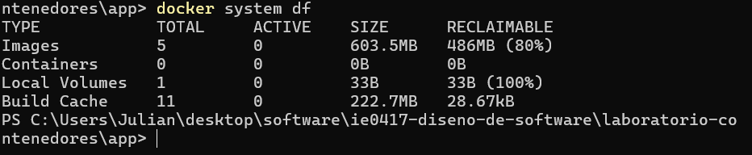

````markdown
# Parte 8: Limpieza del ambiente

## Revisión de recursos existentes

Antes de realizar la limpieza se consultaron los diferentes recursos administrados por Docker.

Para consultar los contenedores se ejecutó:

```bash
docker ps -a
```

Para consultar las imágenes disponibles:

```bash
docker images
```

Para consultar los volúmenes:

```bash
docker volume ls
```

Y para consultar las redes:

```bash
docker network ls
```

Estos comandos permitieron observar los recursos que habían sido creados durante el desarrollo del laboratorio.

## Limpieza de contenedores

Para eliminar los contenedores detenidos que ya no se utilizaban se ejecutó:

```bash
docker container prune
```

Este comando elimina los contenedores que se encuentran detenidos y que ya no son necesarios.

## Limpieza de imágenes

Posteriormente se ejecutó:

```bash
docker image prune
```

Este comando permite eliminar imágenes que Docker considera que ya no están siendo utilizadas.

## Limpieza de volúmenes

También se ejecutó:

```bash
docker volume prune
```

Este comando elimina los volúmenes que no se encuentran asociados con contenedores activos.

Es importante utilizar este comando con cuidado, ya que los volúmenes pueden contener datos persistentes que se desean conservar.

## Uso de espacio en Docker

Finalmente se ejecutó:

```bash
docker system df
```

Este comando muestra información sobre el espacio utilizado por los diferentes recursos de Docker, incluyendo imágenes, contenedores y volúmenes.

### Evidencia



## Diferencia entre limpiar contenedores, imágenes y volúmenes

Eliminar un contenedor elimina una instancia creada a partir de una imagen.

Eliminar una imagen elimina la plantilla utilizada para crear contenedores.

Eliminar un volumen elimina información persistente almacenada de manera independiente de los contenedores.

Debido a esta diferencia, se debe prestar especial atención antes de eliminar volúmenes.

## Preguntas de reflexión

### 1. ¿Por qué Docker puede consumir mucho espacio en disco?

Docker puede almacenar múltiples imágenes, capas, contenedores detenidos, volúmenes y otros recursos. Con el tiempo, estos elementos pueden acumularse y ocupar una cantidad considerable de espacio.

### 2. ¿Qué diferencia hay entre eliminar un contenedor y eliminar una imagen?

Eliminar un contenedor elimina una instancia específica creada a partir de una imagen. Eliminar una imagen elimina la plantilla utilizada para crear uno o varios contenedores.

### 3. ¿Por qué se debe tener cuidado al eliminar volúmenes?

Porque los volúmenes pueden contener información persistente importante. Al eliminar un volumen, también pueden eliminarse permanentemente los datos almacenados en él.

### 4. ¿Qué buenas prácticas aplicaría para mantener limpio su ambiente local?

Es conveniente revisar periódicamente los contenedores, imágenes y volúmenes existentes, eliminar recursos que ya no se utilizan y comprobar el espacio ocupado mediante comandos como `docker system df`.
````