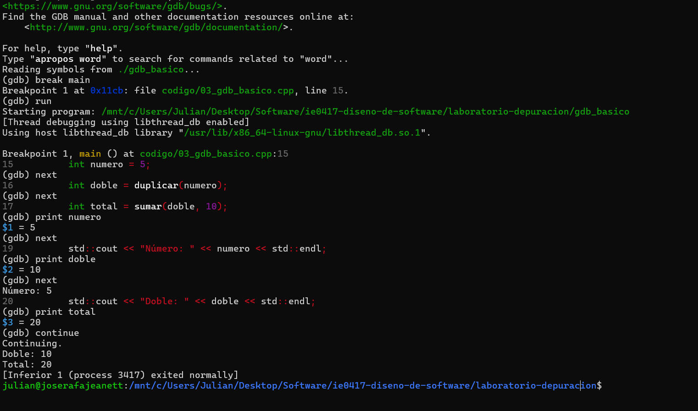

# Parte 3: Introducción a GDB

## Compilación y ejecución

El programa fue compilado utilizando:

```bash
g++ -g -o gdb_basico codigo/03_gdb_basico.cpp
```

Para ejecutarlo normalmente:

```bash
./gdb_basico
```

Para comenzar la depuración:

```bash
gdb ./gdb_basico
```

## Comandos utilizados

- break main: establece un punto de interrupción al inicio de main.
- run: inicia la ejecución del programa.
- next: ejecuta la siguiente línea sin entrar en las funciones llamadas.
- print: permite consultar el valor de una variable.
- continue: reanuda la ejecución del programa.
- quit: cierra el depurador.

## Resultados observados

Durante la depuración se inspeccionaron tres variables:

| Variable | Valor esperado |
|----------|----------------|
| numero | 5 |
| doble | 10 |
| total | 20 |

Estos valores corresponden a las operaciones realizadas por las funciones duplicar y sumar.

## Evidencia de depuración



## Preguntas de reflexión

### 1. ¿Qué es un breakpoint?

Es un punto de interrupción que permite detener temporalmente la ejecución de un programa en una línea o función determinada para analizar su estado.

### 2. ¿Qué diferencia hay entre ejecutar el programa normalmente y ejecutarlo dentro de GDB?

La ejecución normal realiza las instrucciones sin interrupciones programadas por el usuario. Con GDB es posible detener el programa, avanzar paso a paso e inspeccionar los valores de las variables.

### 3. ¿Qué ventaja tiene inspeccionar variables mientras el programa se ejecuta?

Permite verificar si las variables contienen los valores esperados en diferentes momentos de la ejecución y facilita la identificación de errores.

### 4. ¿Por qué next no entra dentro de las funciones?

Porque next ejecuta la llamada a la función como un único paso desde la perspectiva del depurador. Para entrar y examinar las instrucciones internas de una función se utiliza step.
