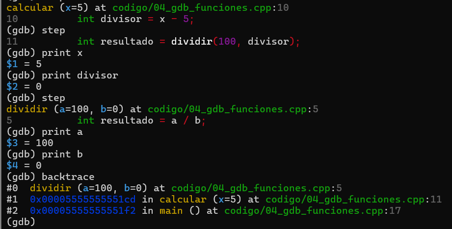

# Parte 4: Step, next y backtrace

## 1. Objetivo

Analizar un error de ejecución utilizando GDB, inspeccionando las variables del programa y la pila de llamadas para identificar la causa del problema.

## 2. Compilación y ejecución inicial

Se compiló el programa utilizando:

```bash
g++ -g -o gdb_funciones codigo/04_gdb_funciones.cpp
```

Después se ejecutó:

```bash
./gdb_funciones
```

### Error observado

El programa compiló correctamente, pero al ejecutarlo presentó el siguiente error:

```text
Floating point exception (core dumped)
```

Esto ocurrió porque el programa intentaba realizar una división entre cero.

## 3. Depuración con GDB

Se inició el depurador mediante:

```bash
gdb ./gdb_funciones
```

Se utilizaron los comandos:

```gdb
break main
run
next
step
step
print x
print divisor
step
print a
print b
backtrace
```

### Valores observados

| Variable | Valor |
|----------|-------|
| x | 5 |
| divisor | 0 |
| a | 100 |
| b | 0 |

Se comprobó que la función calcular recibía el valor 5 y obtenía un divisor igual a cero mediante la operación x - 5.

Posteriormente, la función dividir recibía los argumentos a = 100 y b = 0, provocando una división entre cero.

### Diferencia entre next y step

El comando next permite avanzar a la siguiente línea sin entrar en las funciones llamadas.

El comando step permite entrar en las funciones y examinar sus instrucciones internas.

### Resultado de backtrace

El comando backtrace mostró la siguiente cadena de llamadas:

```text
#0 dividir(a=100, b=0)
#1 calcular(x=5)
#2 main()
```

Esto permitió identificar que el error se originaba en la función dividir, llamada desde calcular, que a su vez había sido llamada desde main.

### Evidencia de depuración



## 4. Corrección realizada

Originalmente, la función dividir realizaba directamente la operación:

```cpp
int resultado = a / b;
```

Se agregó una validación para comprobar que el divisor fuera diferente de cero antes de realizar la división.

Código corregido:

```cpp
int dividir(int a, int b) {
    if (b == 0) {
        std::cout << "Error: no se puede dividir entre cero." << std::endl;
        return 0;
    }

    int resultado = a / b;
    return resultado;
}
```

## 5. Resultado final

Después de corregir el código, se compiló y ejecutó nuevamente:

```bash
g++ -g -o gdb_funciones codigo/04_gdb_funciones.cpp
./gdb_funciones
```

Se obtuvo:

```text
Error: no se puede dividir entre cero.
Respuesta: 0
```

El programa finalizó normalmente y no volvió a presentar el error de ejecución.

## 6. Preguntas de reflexión

### 1. ¿Qué diferencia observó entre next y step?

El comando next permite ejecutar una línea sin entrar en las funciones llamadas, mientras que step permite ingresar a dichas funciones y examinar su ejecución paso a paso.

### 2. ¿Para qué sirve backtrace?

Permite visualizar la pila de llamadas del programa y conocer qué funciones se ejecutaron para llegar al punto actual. Esto facilita identificar el origen de un error.

### 3. ¿Cuál fue la causa del error?

La causa fue una división entre cero. La función calcular obtuvo un divisor igual a cero y lo pasó a la función dividir, donde se intentó realizar la operación 100 / 0.

### 4. ¿Por qué este error es de tiempo de ejecución?

Porque el programa compiló correctamente, pero falló cuando intentó ejecutar una operación inválida. El problema se manifestó durante la ejecución y no durante la compilación.

### 5. ¿Cómo podría prevenirse este tipo de error desde el diseño del programa?

Mediante validaciones de los datos y condiciones previas antes de realizar operaciones que puedan producir errores. En este caso, comprobar que el divisor sea diferente de cero permite evitar el fallo.

## 7. Reflexión

Este ejercicio permitió comprender cómo GDB facilita la identificación de errores que no son detectados durante la compilación. Inspeccionar las variables y utilizar backtrace permitió localizar la división entre cero y comprender la secuencia de llamadas que provocó el problema.
