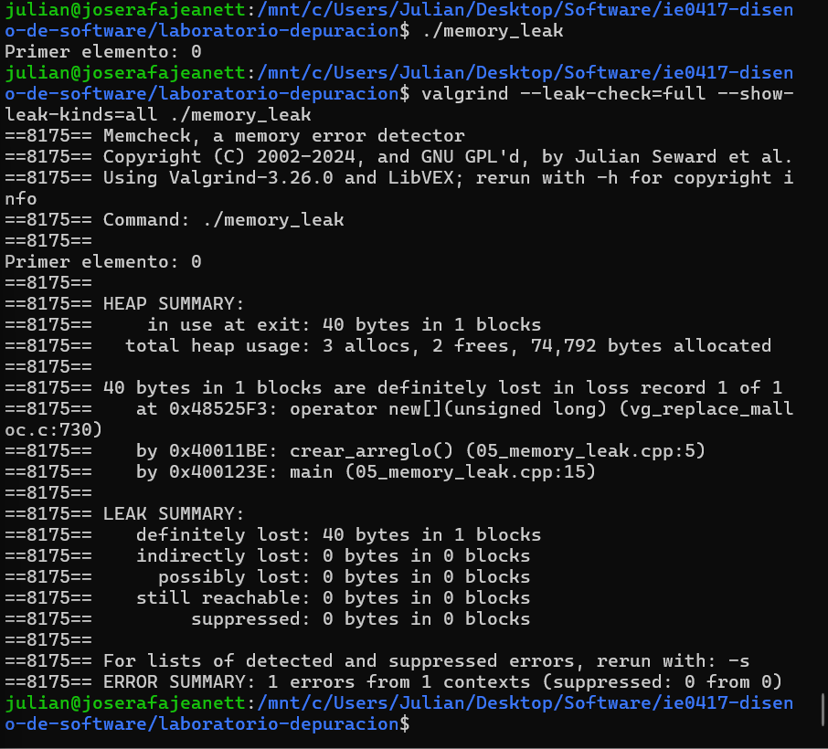
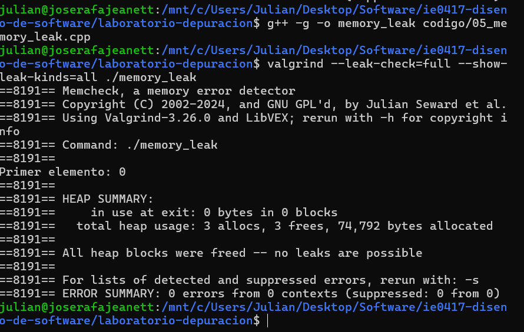
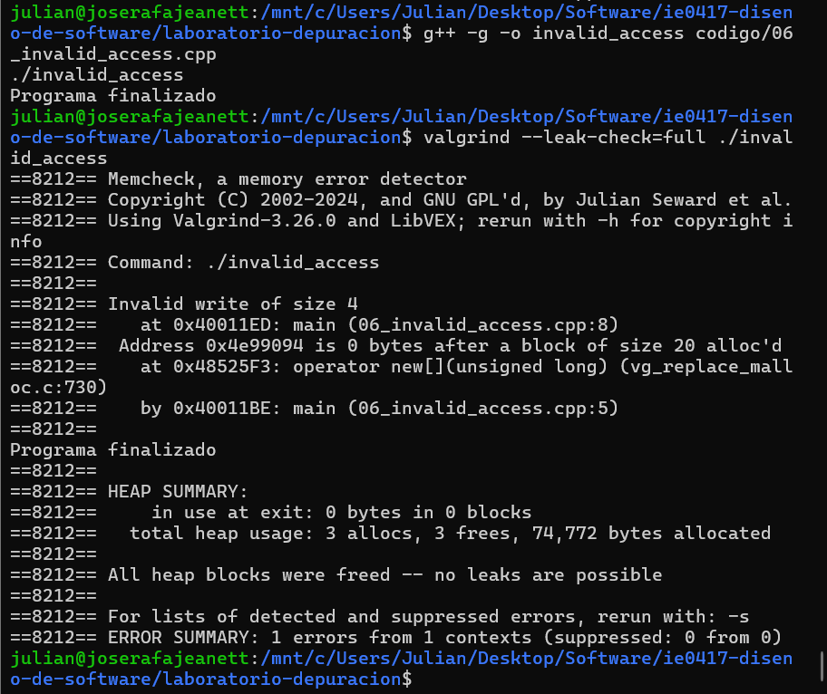
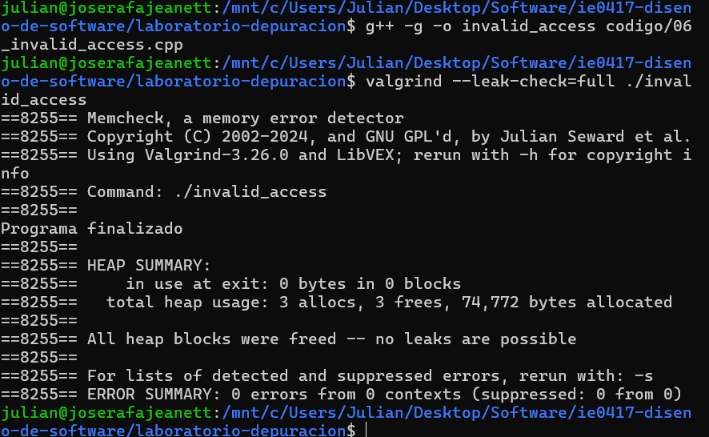

# Parte 5: Análisis de memoria con Valgrind

## Ejercicio 1: Pérdida de memoria (Memory Leak)

### 1. Descripción del programa

El programa reserva memoria dinámicamente para un arreglo de diez números enteros, asigna valores a sus elementos e imprime el primero.

### 2. Error original

El programa utilizaba la siguiente instrucción para reservar memoria:

```cpp
int* datos = new int[10];
```

Sin embargo, al finalizar la función no se liberaba la memoria reservada mediante new[].

### 3. Compilación y ejecución

Comando de compilación:

```bash
g++ -g -o memory_leak codigo/05_memory_leak.cpp
```

Comando de ejecución:

```bash
./memory_leak
```

Resultado observado:

```text
Primer elemento: 0
```

El programa aparentemente funcionaba correctamente, aunque contenía una pérdida de memoria.

### 4. Análisis con Valgrind

Se utilizó el siguiente comando:

```bash
valgrind --leak-check=full --show-leak-kinds=all ./memory_leak
```

Valgrind permitió detectar memoria reservada que no había sido liberada.

El mensaje "definitely lost" indica que el programa perdió todas las referencias a un bloque de memoria dinámica, por lo que ya no puede liberarlo.

En este ejercicio se reservaron diez enteros, equivalentes a 40 bytes en el entorno utilizado.

### 5. Corrección realizada

Se agregó la instrucción:

```cpp
delete[] datos;
```

Esto permite liberar la memoria dinámica del arreglo antes de que termine la función.

### 6. Resultado después de corregir

Se compiló nuevamente el programa y se ejecutó Valgrind.

El resultado esperado después de la corrección es:

```text
All heap blocks were freed -- no leaks are possible
ERROR SUMMARY: 0 errors from 0 contexts
```

La corrección elimina la pérdida de memoria al liberar correctamente el arreglo.

### 7. Evidencias

Reporte inicial:



Reporte después de corregir:



### 8. Preguntas de reflexión

#### 1. ¿Qué es una pérdida de memoria?

Es una situación en la que un programa reserva memoria dinámicamente y pierde la posibilidad de liberarla, provocando que permanezca ocupada innecesariamente.

#### 2. ¿Por qué el programa puede terminar aparentemente bien aunque tenga una pérdida de memoria?

Porque una pérdida de memoria no necesariamente produce un fallo inmediato. El programa puede completar sus operaciones y mostrar resultados correctos, aunque no administre adecuadamente los recursos.

#### 3. ¿Qué significa liberar memoria dinámica?

Significa devolver la memoria reservada durante la ejecución para que pueda volver a utilizarse.

#### 4. ¿Por qué se usa delete[] y no solo delete?

Porque la memoria se reservó mediante new[], que crea un arreglo dinámico. Para liberar correctamente ese tipo de reserva se debe utilizar delete[].

#### 5. ¿Qué tipo de problemas podrían aparecer en programas grandes si no se libera memoria?

Podrían producirse incrementos innecesarios en el consumo de memoria, reducción del rendimiento y agotamiento de los recursos disponibles, especialmente en programas que permanecen ejecutándose durante mucho tiempo.

### 9. Reflexión

El ejercicio permitió comprobar que un programa puede ejecutarse sin mostrar errores visibles y aun así presentar problemas de administración de memoria. Valgrind facilita la identificación de estos problemas y permite verificar si las correcciones funcionan.

## Ejercicio 2: Acceso fuera de los límites de un arreglo

### 1. Descripción del programa

El programa reserva memoria dinámica para un arreglo de cinco números enteros y utiliza un ciclo para asignar valores a sus elementos.

### 2. Error original

El programa utilizaba el siguiente ciclo:

```cpp
for (int i = 0; i <= 5; i++) {
    arreglo[i] = i * 10;
}
```

El problema es que el arreglo solamente tiene cinco posiciones válidas, desde la posición 0 hasta la 4. La condición i <= 5 provoca que también se intente escribir en la posición 5, fuera de los límites del arreglo.

### 3. Compilación y ejecución

Comando de compilación:

```bash
g++ -g -o invalid_access codigo/06_invalid_access.cpp
```

Comando de ejecución:

```bash
./invalid_access
```

Resultado obtenido:

```text
Programa finalizado
```

El programa terminó aparentemente con normalidad, a pesar de contener un acceso inválido a memoria.

### 4. Análisis con Valgrind

Se utilizó el siguiente comando:

```bash
valgrind --leak-check=full ./invalid_access
```

Valgrind reportó:

```text
Invalid write of size 4
at main (06_invalid_access.cpp:8)
Address is 0 bytes after a block of size 20 alloc'd
ERROR SUMMARY: 1 errors from 1 contexts
```

El mensaje "Invalid write of size 4" indica que el programa intentó escribir cuatro bytes fuera del espacio de memoria reservado.

El error ocurrió en la línea 8 del archivo, correspondiente a la escritura en el arreglo.

Aunque Valgrind no detectó pérdidas de memoria, sí identificó un acceso inválido.

### 5. Corrección realizada

Se modificó la condición del ciclo para impedir que accediera a una posición inexistente.

Código corregido:

```cpp
for (int i = 0; i < 5; i++) {
    arreglo[i] = i * 10;
}
```

Ahora el ciclo solamente utiliza los índices del 0 al 4, que corresponden a las posiciones válidas del arreglo.

### 6. Resultado después de corregir

Se compiló nuevamente el programa:

```bash
g++ -g -o invalid_access codigo/06_invalid_access.cpp
```

Se ejecutó Valgrind:

```bash
valgrind --leak-check=full ./invalid_access
```

El programa finalizó normalmente y Valgrind mostró:

```text
ERROR SUMMARY: 0 errors from 0 contexts
```

Esto confirma que el acceso inválido identificado anteriormente fue corregido.

### 7. Evidencias

Antes de la corrección:



Después de la corrección:



### 8. Preguntas de reflexión

#### 1. ¿Por qué el programa podría no fallar aunque acceda fuera del arreglo?

Porque acceder a memoria fuera de los límites de un arreglo produce comportamiento indefinido. En algunos casos el programa puede continuar ejecutándose aparentemente con normalidad, aunque haya realizado una operación inválida.

#### 2. ¿Qué significa escribir fuera de los límites de un arreglo?

Significa intentar modificar una posición de memoria que no pertenece al espacio reservado para el arreglo.

#### 3. ¿Por qué este tipo de error es peligroso?

Porque puede modificar memoria utilizada por otros datos, producir resultados incorrectos, provocar fallos inesperados o generar vulnerabilidades de seguridad.

#### 4. ¿Qué diferencia hay entre un error visible y un comportamiento indefinido?

Un error visible produce una consecuencia que podemos observar directamente, como un mensaje de error o el cierre inesperado del programa. El comportamiento indefinido significa que el lenguaje no garantiza cómo se comportará el programa, por lo que podría fallar, mostrar resultados incorrectos o parecer que funciona normalmente.

### 9. Reflexión

Este ejercicio permitió comprobar que un programa puede presentar errores de memoria aunque aparentemente se ejecute correctamente. Valgrind identificó una escritura fuera de los límites del arreglo y permitió comprobar que la modificación del ciclo eliminó el error detectado.
