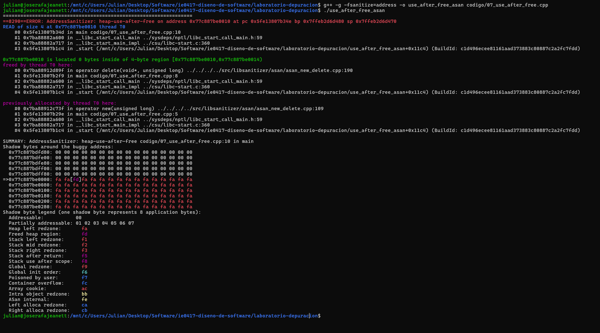
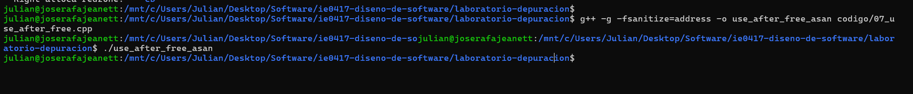

# Parte 6: AddressSanitizer

## 1. Descripción del ejercicio

El objetivo fue identificar y corregir un error de acceso a memoria liberada utilizando AddressSanitizer.

El programa reserva memoria dinámica para un entero, le asigna el valor 42 y posteriormente intenta utilizarla después de haberla liberado.

## 2. Código original

```cpp
#include <iostream>

int main() {
    int* numero = new int;
    *numero = 42;

    delete numero;

    std::cout << "Número: " << *numero << std::endl;

    return 0;
}
```

El error ocurre porque se intenta acceder al contenido del puntero después de liberar la memoria mediante delete.

## 3. Compilación y ejecución

Compilación normal:

```bash
g++ -g -o use_after_free codigo/07_use_after_free.cpp
```

Ejecución:

```bash
./use_after_free
```

Compilación con AddressSanitizer:

```bash
g++ -g -fsanitize=address -o use_after_free_asan codigo/07_use_after_free.cpp
```

Ejecución con AddressSanitizer:

```bash
./use_after_free_asan
```

## 4. Análisis del error

El acceso a memoria liberada se conoce como heap-use-after-free.

Este error ocurre cuando un programa intenta leer o modificar una región de memoria que anteriormente fue liberada.

AddressSanitizer permite detectar este tipo de acceso e identificar la instrucción responsable.

El problema se encuentra en:

```cpp
std::cout << "Número: " << *numero << std::endl;
```

Esta instrucción intenta leer memoria que ya fue liberada mediante delete.

## 5. Corrección realizada

Se modificó el programa para utilizar el valor antes de liberar la memoria.

Código corregido:

```cpp
#include <iostream>

int main() {
    int* numero = new int;
    *numero = 42;

    std::cout << "Número: " << *numero << std::endl;

    delete numero;
    numero = nullptr;

    return 0;
}
```

La corrección evita utilizar la memoria después de liberarla.

## 6. Resultado final

Se compiló nuevamente el programa con AddressSanitizer:

```bash
g++ -g -fsanitize=address -o use_after_free_asan codigo/07_use_after_free.cpp
```

Al ejecutarlo se obtuvo:

```text
Número: 42
```

El programa terminó normalmente sin presentar errores de AddressSanitizer.

## 7. Evidencias

Reporte del programa original:



Ejecución después de corregir:



## 8. Preguntas de reflexión

### 1. ¿Qué significa usar memoria después de liberarla?

Significa intentar acceder a una región de memoria que previamente fue liberada. Esto produce comportamiento indefinido y puede provocar errores o resultados inesperados.

### 2. ¿Por qué este error puede ser difícil de detectar sin herramientas?

Porque el programa puede continuar ejecutándose aparentemente con normalidad. La memoria liberada podría conservar temporalmente su contenido, aunque ya no sea válido acceder a ella.

### 3. ¿Qué ventaja tiene AddressSanitizer sobre ejecutar el programa normalmente?

Permite detectar accesos inválidos a memoria e identificar las instrucciones responsables, incluso cuando el programa podría ejecutarse sin mostrar errores evidentes.

### 4. ¿Qué diferencia observó entre el reporte de Valgrind y el reporte de AddressSanitizer?

Valgrind permite analizar errores de memoria y pérdidas de memoria ejecutando el programa bajo una herramienta de supervisión. AddressSanitizer utiliza comprobaciones incorporadas durante la compilación y proporciona reportes detallados sobre accesos inválidos, como heap-use-after-free.


### Reporte obtenido con AddressSanitizer

Al ejecutar el programa original, AddressSanitizer detectó el siguiente error:

```text
ERROR: AddressSanitizer: heap-use-after-free
READ of size 4
#0 in main codigo/07_use_after_free.cpp:10
```

El reporte identificó que la memoria fue reservada en la línea 5, liberada en la línea 8 y utilizada incorrectamente en la línea 10.

Esto permitió localizar el problema y comprobar que se estaba accediendo a memoria después de liberarla.


### 5. ¿Por qué es buena práctica asignar nullptr después de liberar un puntero?

Porque permite indicar que el puntero ya no apunta a una dirección válida. Esto facilita comprobar si es nulo antes de utilizarlo y reduce el riesgo de reutilizar accidentalmente la dirección liberada. Sin embargo, no protege otros punteros que puedan apuntar a esa misma memoria.

## 9. Reflexión

Este ejercicio permitió comprender que liberar memoria no garantiza que un programa deje de intentar utilizarla. AddressSanitizer facilita la identificación de estos errores y ayuda a verificar que las correcciones realizadas eviten los accesos inválidos.
