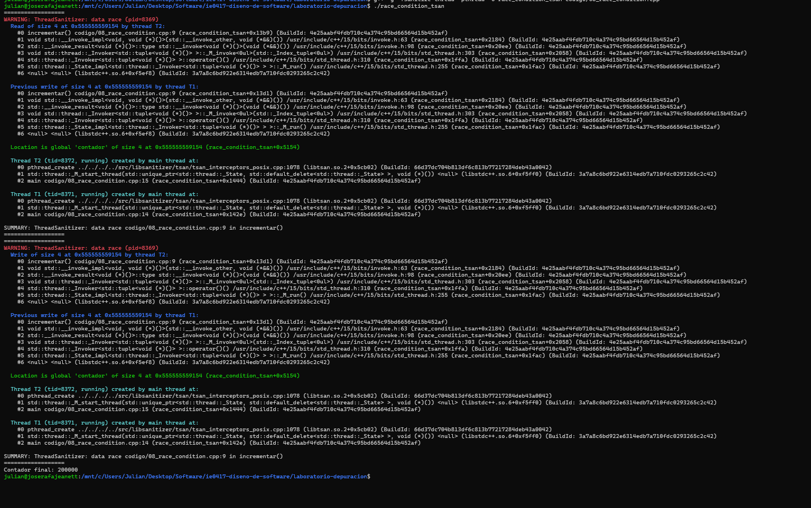
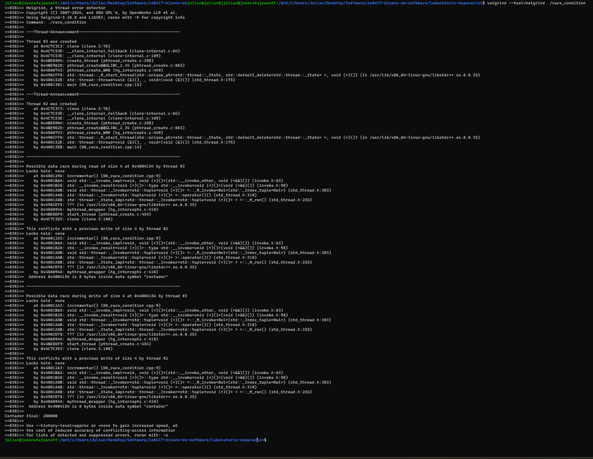
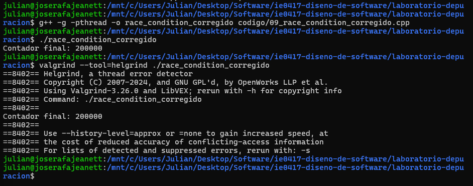
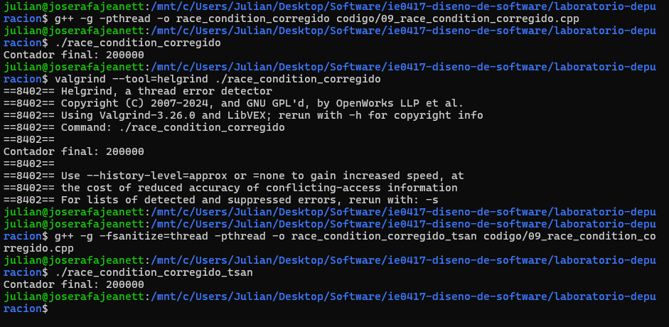

# Parte 7: Análisis de hilos y condiciones de carrera

## 1. Objetivo

Identificar una condición de carrera en un programa multihilo utilizando ThreadSanitizer y Helgrind, y corregirla mediante mecanismos de sincronización.

## 2. Programa original

El programa crea dos hilos que incrementan una variable global compartida llamada contador.

Cada hilo realiza 100000 incrementos, por lo que el resultado esperado es 200000.

El código original utiliza la siguiente función:

```cpp
int contador = 0;

void incrementar() {
    for (int i = 0; i < 100000; i++) {
        contador++;
    }
}
```

El problema es que ambos hilos modifican la variable sin utilizar mecanismos de sincronización.

## 3. Compilación y ejecución inicial

Se compiló el programa mediante:

```bash
g++ -g -pthread -o race_condition codigo/08_race_condition.cpp
```

Se ejecutó tres veces utilizando:

```bash
./race_condition
```

### Resultados obtenidos

| Ejecución | Valor esperado | Valor obtenido |
|-----------|----------------|----------------|
| 1 | 200000 | 196037 |
| 2 | 200000 | 200000 |
| 3 | 200000 | 191984 |

Los resultados variaron entre las ejecuciones. En dos ocasiones se obtuvo un valor inferior al esperado, mientras que en una ejecución se alcanzó el resultado correcto.

Esto demuestra que la falta de sincronización puede provocar la pérdida de incrementos, aunque el problema no necesariamente produzca resultados incorrectos en todas las ejecuciones.

## 4. Análisis con ThreadSanitizer

Se compiló utilizando:

```bash
g++ -g -fsanitize=thread -pthread -o race_condition_tsan codigo/08_race_condition.cpp
```

Después se ejecutó:

```bash
./race_condition_tsan
```

### Resultado observado

ThreadSanitizer reportó:

```text
WARNING: ThreadSanitizer: data race
Read of size 4
Previous write of size 4
codigo/08_race_condition.cpp:9
Location is global 'contador'
```

La herramienta identificó accesos conflictivos de lectura y escritura sobre la variable global contador, específicamente en la línea 9 de la función incrementar().

Aunque esta ejecución produjo un contador final de 200000, ThreadSanitizer detectó igualmente la condición de carrera.

### Evidencia



## 5. Análisis con Helgrind

Se ejecutó el programa original mediante:

```bash
valgrind --tool=helgrind ./race_condition
```

### Resultado observado

Helgrind identificó los siguientes problemas:

```text
Possible data race during read of size 4
Possible data race during write of size 4
Locks held: none
incrementar() (08_race_condition.cpp:9)
```

El reporte mostró que varios hilos accedían a la variable contador sin mantener ningún bloqueo.

Ambas herramientas permitieron identificar el mismo problema de concurrencia.

### Evidencia



## 6. Corrección utilizando mutex

Se creó el archivo codigo/09_race_condition_corregido.cpp.

Se agregó un mutex para proteger los incrementos de la variable compartida:

```cpp
#include <mutex>

int contador = 0;
std::mutex mtx;

void incrementar() {
    for (int i = 0; i < 100000; i++) {
        std::lock_guard<std::mutex> lock(mtx);
        contador++;
    }
}
```

El mutex permite que solamente un hilo a la vez ejecute la sección crítica, evitando que se pierdan incrementos.

## 7. Verificación del programa corregido

Se compiló el programa:

```bash
g++ -g -pthread -o race_condition_corregido codigo/09_race_condition_corregido.cpp
```

Se ejecutó:

```bash
./race_condition_corregido
```

Resultado obtenido:

```text
Contador final: 200000
```

### Verificación con Helgrind

Se utilizó:

```bash
valgrind --tool=helgrind ./race_condition_corregido
```

El programa obtuvo 200000 y Helgrind no reportó condiciones de carrera.

### Verificación con ThreadSanitizer

Se compiló mediante:

```bash
g++ -g -fsanitize=thread -pthread -o race_condition_corregido_tsan codigo/09_race_condition_corregido.cpp
```

Se ejecutó:

```bash
./race_condition_corregido_tsan
```

Resultado obtenido:

```text
Contador final: 200000
```

ThreadSanitizer no mostró advertencias de data race.

Esto confirma que la corrección eliminó la condición de carrera detectada anteriormente en las pruebas realizadas.

### Evidencias de la corrección





## 8. Preguntas de reflexión

### 1. ¿Por qué contador++ no es una operación segura entre varios hilos?

Porque incrementar una variable implica consultar su valor, modificarlo y almacenar el resultado. Si varios hilos realizan estas operaciones simultáneamente sin sincronización, pueden sobrescribirse actualizaciones y perderse incrementos.

### 2. ¿Qué significa que dos hilos accedan a la misma variable compartida?

Significa que ambos hilos pueden leer o modificar una misma región de memoria. Si al menos uno modifica la variable y no existe sincronización adecuada, puede producirse una condición de carrera.

### 3. ¿Qué problema resuelve std::mutex?

Permite controlar el acceso a recursos compartidos, garantizando que solamente un hilo a la vez pueda ejecutar una sección crítica protegida por el mismo mutex.

### 4. ¿Qué hace std::lock_guard?

Administra automáticamente el bloqueo y desbloqueo de un mutex. Lo bloquea al crearse y lo libera al finalizar su ámbito, reduciendo el riesgo de errores relacionados con el manejo manual de bloqueos.

### 5. ¿Por qué los errores de concurrencia pueden ser difíciles de reproducir?

Porque dependen del orden de ejecución de los hilos, el cual puede variar según la planificación del sistema operativo. Por eso, un programa puede presentar resultados correctos en algunas ejecuciones e incorrectos en otras.

### 6. ¿Cuál herramienta le pareció más clara para analizar este caso: ThreadSanitizer o Helgrind?

ThreadSanitizer resultó más clara para identificar el problema, porque mostró directamente la advertencia data race, los accesos conflictivos y la línea del código donde ocurrían.

Helgrind también proporcionó información útil, especialmente al indicar que no existía ningún bloqueo protegiendo los accesos.

## 9. Reflexión

Este ejercicio permitió comprobar que las condiciones de carrera pueden existir incluso cuando el programa produce el resultado esperado.

ThreadSanitizer y Helgrind facilitaron la identificación de los accesos conflictivos a memoria. Posteriormente, el uso de std::mutex permitió corregir el problema y verificar que ambas herramientas dejaron de reportar condiciones de carrera.
