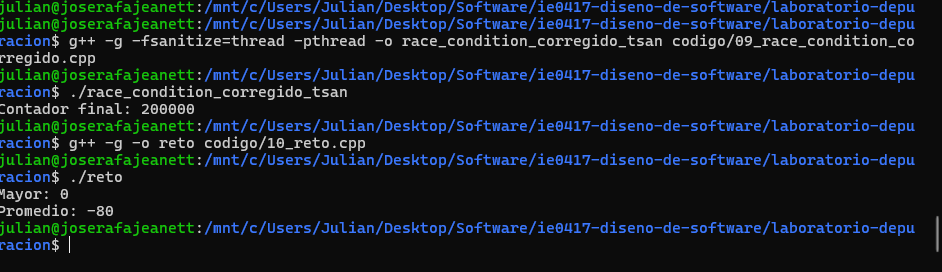
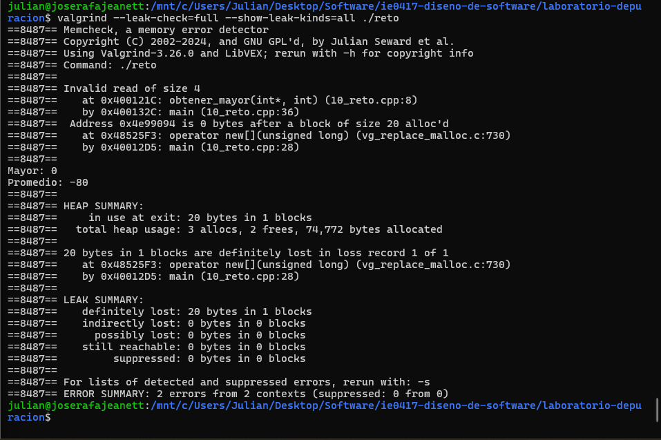
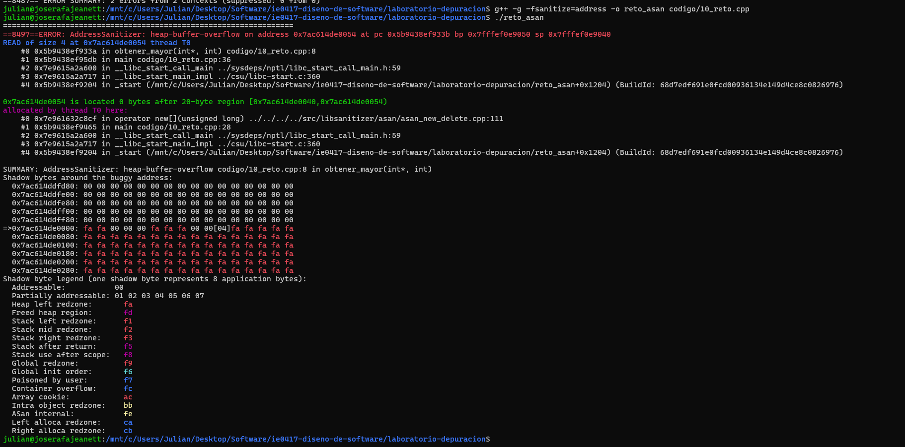
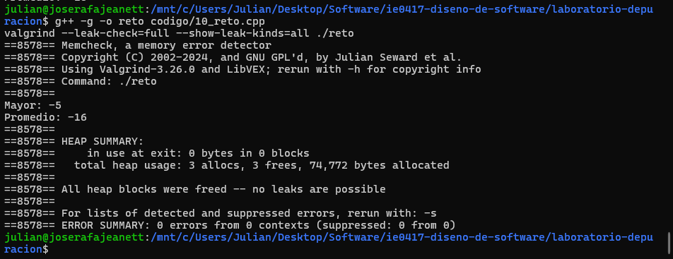
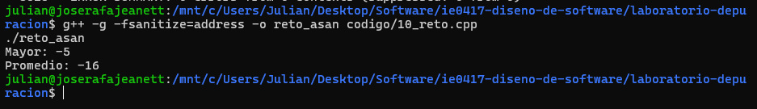

# Parte 8: Mini reto de depuración y reflexión final

## Mini reto de depuración

### 1. Descripción del ejercicio

El objetivo fue identificar y corregir diferentes errores en un programa de C++ que calcula el mayor elemento y el promedio de un arreglo.

Para analizar los problemas se utilizaron la ejecución normal, Valgrind y AddressSanitizer.

### 2. Compilación y ejecución inicial

Se compiló el programa original mediante:

```bash
g++ -g -o reto codigo/10_reto.cpp
```

Después se ejecutó:

```bash
./reto
```

El programa produjo los siguientes resultados:

```text
Mayor: 0
Promedio: -80
```

Sin embargo, los resultados correctos eran:

```text
Mayor: -5
Promedio: -16
```

Esto permitió identificar que existían errores en los cálculos.

### 3. Análisis con Valgrind

Se ejecutó el siguiente comando:

```bash
valgrind --leak-check=full --show-leak-kinds=all ./reto
```

Valgrind detectó dos problemas:

```text
Invalid read of size 4
at obtener_mayor(int*, int) (10_reto.cpp:8)

definitely lost: 20 bytes in 1 blocks

ERROR SUMMARY: 2 errors from 2 contexts
```

El primer error indicaba que el programa intentaba acceder a una posición fuera de los límites del arreglo.

El segundo mostraba que se habían reservado 20 bytes de memoria que nunca fueron liberados.

### 4. Análisis con AddressSanitizer

Se compiló utilizando:

```bash
g++ -g -fsanitize=address -o reto_asan codigo/10_reto.cpp
```

Después se ejecutó:

```bash
./reto_asan
```

AddressSanitizer reportó:

```text
ERROR: AddressSanitizer: heap-buffer-overflow
READ of size 4
obtener_mayor(int*, int)
codigo/10_reto.cpp:8
```

Esto confirmó que la función obtener_mayor intentaba leer una posición de memoria fuera del espacio reservado para el arreglo.

### 5. Errores encontrados y correcciones

#### Error 1: Cálculo incorrecto del mayor

Originalmente, la variable mayor se inicializaba en cero:

```cpp
int mayor = 0;
```

Como todos los elementos del arreglo eran negativos, ninguno era mayor que cero. Por eso el programa devolvía incorrectamente el valor 0.

Se corrigió inicializando la variable con el primer elemento:

```cpp
int mayor = datos[0];
```

De esta manera, las comparaciones se realizan utilizando un valor real del arreglo.

#### Error 2: Acceso fuera de los límites

El ciclo original utilizaba:

```cpp
for (int i = 0; i <= tamano; i++)
```

Esta condición permitía acceder a la posición datos[5], aunque el arreglo solamente contenía cinco elementos.

Se corrigió mediante:

```cpp
for (int i = 1; i < tamano; i++)
```

Ahora el recorrido comienza en el segundo elemento, ya que el primero se utilizó para inicializar mayor, y termina dentro de los límites del arreglo.

#### Error 3: Promedio incorrecto

La función calcular_promedio sumaba los elementos, pero retornaba directamente la suma.

Se corrigió mediante:

```cpp
return static_cast<double>(suma) / tamano;
```

Esto permite calcular el promedio y obtener resultados decimales cuando corresponde.

#### Error 4: Pérdida de memoria

El programa reservaba memoria mediante:

```cpp
int* datos = new int[tamano];
```

Sin embargo, nunca liberaba dicha memoria.

Se agregó la siguiente instrucción antes de finalizar main:

```cpp
delete[] datos;
```

Esto permite liberar correctamente el arreglo dinámico.

### 6. Resultado final

Después de aplicar las correcciones, se compiló y ejecutó nuevamente el programa.

Se obtuvo:

```text
Mayor: -5
Promedio: -16
```

La versión corregida también se ejecutó con AddressSanitizer, finalizando normalmente sin reportar errores de memoria.

Para verificar la corrección con Valgrind se utilizó:

```bash
valgrind --leak-check=full --show-leak-kinds=all ./reto
```

### 7. Evidencias

Ejecución original:



Reporte original de Valgrind:



Reporte original de AddressSanitizer:



Verificación posterior con Valgrind:



Verificación posterior con AddressSanitizer:



### 8. Herramienta más útil

Valgrind resultó especialmente útil porque permitió identificar tanto el acceso inválido como la pérdida de memoria en una misma ejecución.

AddressSanitizer también fue útil, ya que identificó directamente el desbordamiento del arreglo e indicó la línea donde ocurría.

### 9. Reflexión del reto

Este ejercicio demostró que un mismo programa puede contener errores lógicos y errores de memoria al mismo tiempo. También permitió comprobar que un programa puede ejecutarse y mostrar resultados sin que eso garantice su correcto funcionamiento.

El uso de herramientas de depuración facilitó la identificación de problemas que no eran evidentes mediante la ejecución normal.

---

## Reflexión final

### 1. ¿Qué entiende ahora por depuración?

La depuración es el proceso de identificar, analizar y corregir errores en un programa. Implica observar su comportamiento, localizar las causas de los problemas y verificar que las modificaciones realizadas funcionen correctamente.

### 2. ¿Por qué no basta con que un programa compile?

Porque la compilación no garantiza que el programa produzca resultados correctos ni que administre adecuadamente los recursos. Pueden existir errores lógicos, accesos inválidos a memoria o problemas de concurrencia que solamente se manifiestan durante la ejecución.

### 3. ¿Cuál fue la diferencia entre un error de sintaxis y un error lógico?

Un error de sintaxis incumple las reglas del lenguaje y normalmente impide compilar el programa. Un error lógico permite que el programa compile y se ejecute, pero provoca resultados incorrectos debido a fallos en el procedimiento utilizado.

### 4. ¿Qué ventaja tiene usar gdb?

Permite detener la ejecución en puntos específicos, inspeccionar variables, avanzar paso a paso y examinar la pila de llamadas. Esto facilita comprender cómo se produce un error y localizar su origen.

### 5. ¿Qué ventaja tiene usar valgrind?

Permite identificar problemas relacionados con la memoria, como pérdidas de memoria y accesos inválidos. Además, proporciona información sobre las instrucciones responsables y permite comprobar si las correcciones eliminaron los errores.

### 6. ¿Qué ventaja tiene usar AddressSanitizer?

Permite detectar errores de memoria mediante comprobaciones incorporadas al programa durante la compilación. Sus reportes ayudan a localizar problemas como accesos fuera de límites y uso de memoria después de liberarla.

### 7. ¿Qué aprendió sobre errores de memoria?

Aprendí que un programa puede contener errores de memoria aunque aparentemente funcione correctamente. También comprendí la importancia de respetar los límites de los arreglos, liberar la memoria dinámica y evitar utilizar punteros después de liberar los recursos a los que apuntan.

### 8. ¿Qué aprendió sobre errores de concurrencia?

Aprendí que varios hilos pueden producir resultados incorrectos cuando modifican recursos compartidos sin sincronización. Herramientas como ThreadSanitizer y Helgrind permiten identificar estas condiciones, mientras que mutex permite proteger las secciones críticas.

### 9. ¿Cuál fue el error más fácil de encontrar?

El error de sintaxis fue el más sencillo, porque el compilador mostró directamente un mensaje indicando que faltaba un punto y coma.

### 10. ¿Cuál fue el error más difícil de entender?

Las condiciones de carrera fueron de los problemas más complejos, porque no siempre producen resultados incorrectos y dependen de cómo se intercalan las operaciones de los diferentes hilos.

### 11. ¿Qué herramienta usaría primero si un programa produce un resultado incorrecto?

Primero ejecutaría el programa con diferentes datos y compararía los resultados con los esperados. Si la causa no es evidente, utilizaría GDB para inspeccionar variables y seguir la ejecución paso a paso.

### 12. ¿Qué herramienta usaría primero si un programa falla con segmentation fault?

Utilizaría GDB para identificar la instrucción donde ocurrió el fallo y revisar la pila de llamadas. También podría utilizar AddressSanitizer si sospecho que el problema está relacionado con un acceso inválido a memoria.

### 13. ¿Qué herramienta usaría primero si sospecha una pérdida de memoria?

Utilizaría Valgrind con Memcheck, ya que permite identificar bloques de memoria que fueron reservados y no se liberaron correctamente.

### 14. ¿Qué herramienta usaría primero si sospecha un problema con hilos?

Utilizaría ThreadSanitizer para identificar posibles condiciones de carrera. También podría utilizar Helgrind para analizar accesos conflictivos y mecanismos de sincronización.

### 15. ¿Cómo aplicaría estas herramientas en proyectos futuros?

Las utilizaría durante el desarrollo y las pruebas para identificar errores antes de finalizar los proyectos. GDB sería útil para investigar problemas de ejecución, Valgrind y AddressSanitizer para analizar memoria, y ThreadSanitizer o Helgrind para revisar programas con múltiples hilos.

## Conclusión general

El laboratorio permitió practicar diferentes técnicas de depuración en C++, desde la identificación de errores de sintaxis y lógica hasta el análisis de memoria y concurrencia.

Se comprobó la importancia de utilizar herramientas especializadas para localizar problemas que no siempre son evidentes durante la ejecución normal.

También se reforzó la necesidad de verificar los resultados después de cada corrección y documentar el proceso seguido para comprender las causas de los errores.
