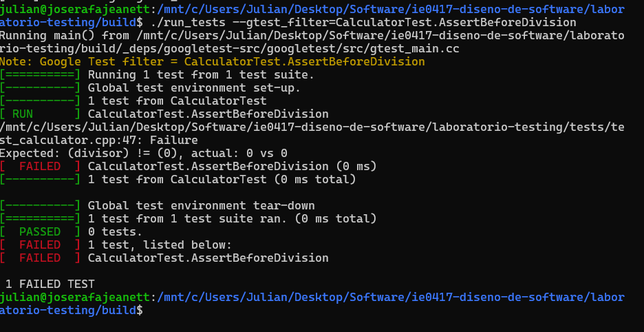
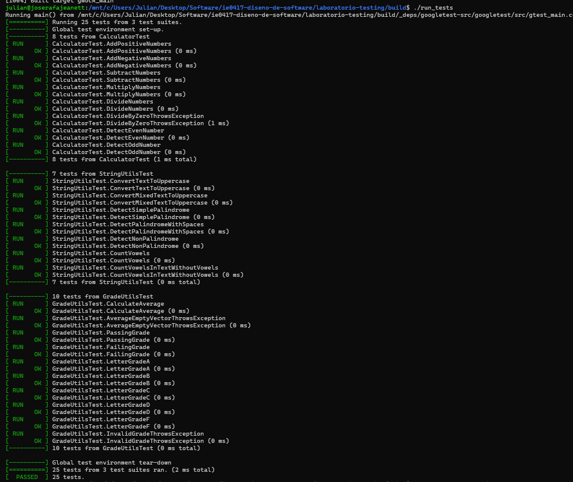
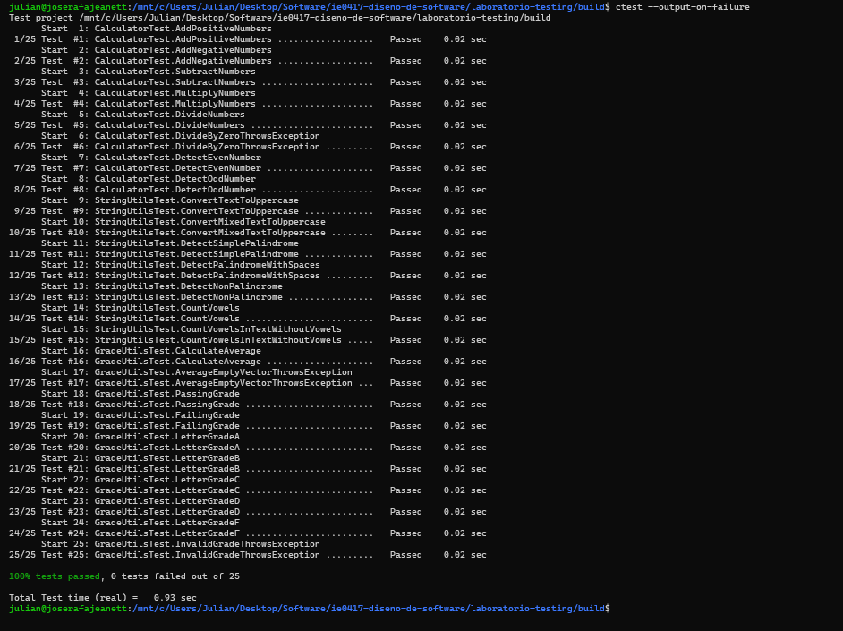

## Parte 4. Diferencias entre EXPECT y ASSERT

Se implementaron dos pruebas adicionales en el archivo
tests/test_calculator.cpp para comparar el comportamiento
de EXPECT y ASSERT.

### Prueba con EXPECT

Se implementó MultipleExpectChecks, que realiza tres
comprobaciones de suma mediante EXPECT_EQ.

EXPECT permite continuar ejecutando las siguientes
comprobaciones aunque alguna falle.

### Prueba con ASSERT

Se implementó AssertBeforeDivision, que utiliza ASSERT_NE
para comprobar que el divisor sea diferente de cero.

Inicialmente, con divisor = 2, la prueba se ejecutó
correctamente.

Posteriormente, se modificó el divisor a cero para
provocar un fallo intencional.

Google Test detectó que la condición ASSERT_NE(divisor, 0)
no se cumplía y detuvo la ejecución de esa prueba antes
de realizar la división.

Finalmente, se restauró divisor = 2 y se ejecutaron
nuevamente las pruebas.

### Diferencias observadas

EXPECT registra un fallo, pero permite continuar con
las siguientes instrucciones de la prueba.

ASSERT detiene inmediatamente la prueba cuando la
condición evaluada no se cumple.

ASSERT resulta especialmente útil cuando continuar
podría producir errores adicionales o resultados inválidos.

### Evidencia del fallo



## Parte 2. Implementación inicial del código

### Módulos implementados

Se implementaron tres módulos principales en C++:

- calculator: operaciones matemáticas y verificación de números pares.
- string_utils: conversión de cadenas a mayúsculas, identificación de palíndromos y conteo de vocales.
- grade_utils: cálculo de promedios, identificación de notas aprobatorias y conversión de calificaciones numéricas a letras.

### Función de los archivos

Los archivos .h contienen las declaraciones de las funciones y permiten que otros archivos del proyecto conozcan sus interfaces.

Los archivos .cpp contienen la implementación de las funciones y las instrucciones necesarias para realizar sus operaciones.

Esta separación facilita la organización, reutilización y mantenimiento del código.

### Casos normales, borde e inválidos

En calculator se identificaron casos normales como sumas y multiplicaciones, casos borde como operaciones con cero y casos inválidos como divisiones entre cero.

En string_utils se identificaron casos normales como convertir texto a mayúsculas, casos borde como cadenas vacías y cadenas de un solo carácter.

En grade_utils se identificaron casos normales como calcular promedios y convertir calificaciones, casos borde como notas de 0, 70 y 100, y casos inválidos como listas vacías o calificaciones fuera del intervalo permitido.

## Parte 3. Primeras pruebas unitarias

### Objetivo

Implementar pruebas automatizadas mediante Google Test para verificar el funcionamiento individual de las funciones desarrolladas.

### Pruebas implementadas

Inicialmente se implementaron 25 pruebas distribuidas de la siguiente manera:

| Módulo | Pruebas |
|---|---|
| CalculatorTest | 8 |
| StringUtilsTest | 7 |
| GradeUtilsTest | 10 |
| Total | 25 |

### Comandos utilizados

Desde la carpeta build se ejecutaron los siguientes comandos:

```bash
cmake ..
make
./run_tests
ctest --output-on-failure
```

### Resultados

Las 25 pruebas iniciales se ejecutaron correctamente.

También se utilizó CTest, que permitió verificar la ejecución de las pruebas integradas con CMake.

### Explicación de cinco pruebas

#### 1. AddPositiveNumbers

Comprueba que la función add() retorne el resultado correcto al sumar dos números positivos.

Se evalúa add(2, 3) y se espera obtener 5.

#### 2. DivideByZeroThrowsException

Verifica que la función divide() produzca una excepción de tipo std::invalid_argument cuando el divisor es cero.

Esta prueba permite comprobar que el programa maneja una operación inválida.

#### 3. DetectSimplePalindrome

Comprueba que is_palindrome("radar") devuelva true, porque la cadena se lee igual en ambos sentidos.

#### 4. CalculateAverage

Verifica que average() calcule correctamente el promedio de las calificaciones 80, 90 y 100.

El resultado esperado es 90.

#### 5. InvalidGradeThrowsException

Comprueba que letter_grade(120) produzca una excepción, debido a que 120 está fuera del intervalo válido de calificaciones.

### Evidencias





### Preguntas de reflexión

#### 1. ¿Qué significa que una prueba pase?

Significa que las comprobaciones realizadas durante esa prueba se cumplieron y que el resultado observado coincidió con lo esperado.

#### 2. ¿Qué significa que una prueba falle?

Significa que alguna comprobación no produjo el resultado esperado o que ocurrió un problema durante la ejecución.

#### 3. ¿Qué diferencia hay entre probar una función manualmente y probarla con Google Test?

Las pruebas manuales requieren ejecutar y revisar los resultados individualmente. Google Test automatiza las comprobaciones y permite ejecutarlas repetidamente.

#### 4. ¿Por qué las pruebas unitarias deben ser rápidas?

Porque suelen ejecutarse frecuentemente durante el desarrollo. Una ejecución rápida facilita detectar errores después de modificar el código.

#### 5. ¿Por qué las pruebas unitarias deben ser deterministas?

Porque deben producir resultados consistentes bajo las mismas condiciones. Esto permite identificar errores y reproducir fallos de manera confiable.

## Preguntas adicionales sobre EXPECT y ASSERT

### 1. ¿Cuándo conviene usar EXPECT_?

Cuando se desea registrar un fallo sin detener inmediatamente la prueba, permitiendo continuar con otras comprobaciones.

### 2. ¿Cuándo conviene usar ASSERT_?

Cuando una condición es indispensable para continuar la prueba de manera segura o para que las siguientes verificaciones tengan sentido.

### 3. ¿Qué podría pasar si se usa EXPECT_ cuando en realidad se necesitaba detener la prueba?

La prueba podría continuar utilizando valores inválidos y generar errores adicionales o resultados que dificulten identificar el problema original.

### 4. ¿Qué podría pasar si se usa ASSERT_ en exceso?

Se podría interrumpir la ejecución antes de realizar otras verificaciones independientes, reduciendo la información obtenida sobre posibles fallos.
