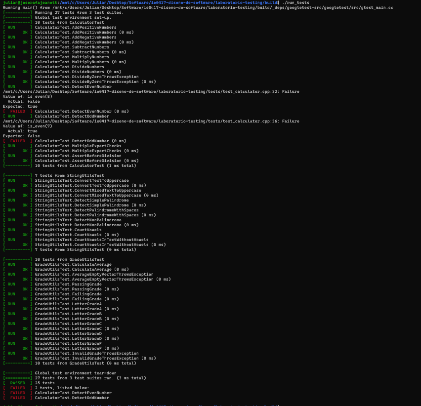
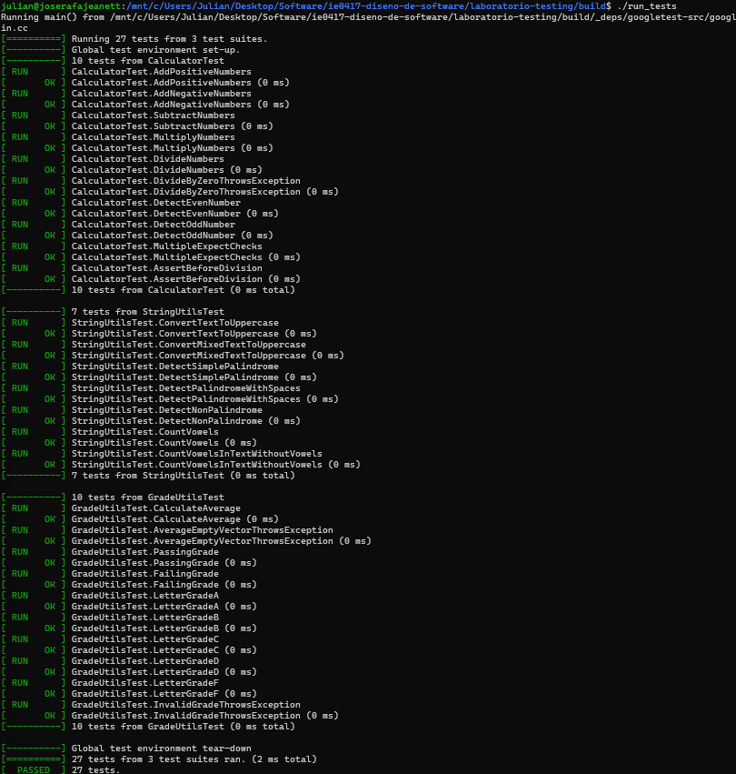

# Parte 5. Pruebas fallidas y corrección de errores

## Objetivo

Comprobar cómo las pruebas automatizadas permiten identificar errores introducidos durante el desarrollo de software y verificar que las correcciones restauren el comportamiento esperado.

## Error introducido

Se modificó intencionalmente la función `is_even()` del archivo `src/calculator.cpp`.

La implementación original utilizaba la condición:

```cpp
return number % 2 == 0;
```

Se reemplazó por:

```cpp
return number % 2 == 1;
```

Este cambio provoca que la función deje de identificar correctamente los números pares.

## Ejecución de las pruebas

Después de introducir el error, se ejecutaron los siguientes comandos desde la carpeta `build`:

```bash
make
./run_tests
```

Google Test identificó fallos en las pruebas `DetectEvenNumber` y `DetectOddNumber`.

La primera esperaba que `is_even(8)` devolviera `true`, pero obtuvo `false`.

La segunda esperaba que `is_even(7)` devolviera `false`, pero obtuvo `true`.

De las 27 pruebas ejecutadas, 25 fueron exitosas y 2 fallaron.

## Evidencia del error



## Corrección implementada

Se restauró la condición original:

```cpp
return number % 2 == 0;
```

Posteriormente, se compiló y ejecutó nuevamente el programa.

Las 27 pruebas se completaron correctamente, lo que permitió verificar que el error introducido había sido corregido.

## Evidencia de la corrección



## Preguntas de reflexión

### 1. ¿Cómo ayudó Google Test a identificar el error?

Permitió detectar automáticamente que los resultados de la función no coincidían con los valores esperados por las pruebas.

### 2. ¿Qué información útil muestra una prueba fallida?

Muestra el nombre de la prueba, la ubicación de la comprobación, el resultado esperado y el resultado obtenido, lo que facilita identificar el problema.

### 3. ¿Por qué es importante ejecutar pruebas después de modificar código?

Porque una modificación puede introducir errores en funcionalidades que anteriormente trabajaban correctamente.

### 4. ¿Qué riesgo existe si se cambia código y no se ejecutan las pruebas?

Existe el riesgo de conservar errores sin detectar y de afectar otras partes del programa antes de su entrega o utilización.
