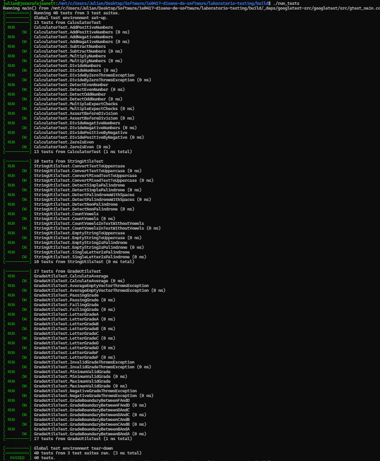

# Parte 6. Diseño de casos borde

## Objetivo

Evaluar el comportamiento de las funciones implementadas ante valores límite, entradas especiales y condiciones que podrían provocar errores no detectados mediante pruebas normales.

## ¿Qué es un caso borde?

Un caso borde es una prueba diseñada para comprobar el comportamiento de un programa en los límites de sus condiciones de funcionamiento.

Estos casos son importantes porque muchos errores aparecen cuando una entrada se encuentra exactamente en un límite o muy cerca de él.

## Casos implementados

### Calculadora

Se agregaron tres pruebas:

- División entre dos números negativos.
- División de un número positivo entre uno negativo.
- Verificación de que cero es un número par.

Estas pruebas permiten comprobar situaciones que no habían sido consideradas en las pruebas iniciales.

### Cadenas de texto

Se agregaron tres pruebas:

- Conversión a mayúsculas de una cadena vacía.
- Identificación de una cadena vacía como palíndromo.
- Identificación de una cadena de un solo carácter como palíndromo.

Estas pruebas verifican el funcionamiento de las funciones con entradas mínimas.

### Calificaciones

Se agregaron siete pruebas para comprobar:

- La calificación mínima permitida (0).
- La calificación máxima permitida (100).
- El rechazo de una calificación negativa.
- Los límites entre F y D.
- Los límites entre D y C.
- Los límites entre C y B.
- Los límites entre B y A.

Estas pruebas permiten verificar que las comparaciones utilizadas para asignar calificaciones se comporten correctamente.

## Ejecución y resultados

Se utilizaron los comandos:

```bash
make
./run_tests
ctest --output-on-failure
```

Se ejecutaron 40 pruebas unitarias, todas exitosas.

No se identificaron errores adicionales durante esta ejecución.

## Evidencia



## Preguntas de reflexión

### 1. ¿Por qué no basta con probar casos normales?

Porque las funciones pueden comportarse correctamente con entradas habituales y presentar errores al recibir valores extremos, vacíos o fuera de los rangos permitidos.

### 2. ¿Qué es un caso borde?

Es una prueba que evalúa el comportamiento del programa en los límites de sus condiciones de funcionamiento.

### 3. ¿Qué es un caso inválido?

Es una entrada que no cumple las condiciones establecidas para una función. Por ejemplo, una calificación negativa o superior a 100.

### 4. ¿Qué diferencia hay entre probar 85 y probar exactamente 80, 90 o 70?

El valor 85 permite comprobar un caso normal de calificación B, mientras que 80, 90 y 70 representan límites donde cambia la clasificación de las notas.

### 5. ¿Cómo puede un caso borde revelar errores ocultos?

Puede detectar comparaciones incorrectas, errores en los límites permitidos y comportamientos que no aparecen al probar valores habituales.

## Parte 7. Semillas en pruebas

### Objetivo

Comprender cómo una semilla fija permite reproducir secuencias de números pseudoaleatorios durante la ejecución de pruebas automatizadas.

### Implementación

Se agregó la prueba `RandomAdditionsWithFixedSeed` en el archivo `tests/test_calculator.cpp`.

Se utilizó el generador `std::mt19937` con la semilla 12345 y una distribución uniforme de números enteros entre -100 y 100.

La prueba generó diez pares de números y comprobó que la función `add()` realizara correctamente las sumas correspondientes.

### Cambio de semilla

Inicialmente se utilizó la semilla 12345. Posteriormente, se modificó temporalmente a 54321 para ejecutar nuevamente la prueba.

Ambas ejecuciones fueron exitosas. Aunque el cambio de semilla modifica la secuencia de valores generados, las operaciones verificadas continuaron produciendo los resultados esperados.

Finalmente, se restauró la semilla original 12345.

### Importancia de las semillas

El uso de semillas fijas permite reproducir las mismas secuencias de entrada, facilitando la identificación y corrección de errores.

Esto resulta especialmente importante durante la depuración, ya que permite repetir las condiciones utilizadas cuando ocurrió un fallo.

### Preguntas de reflexión

#### 1. ¿Por qué las pruebas con datos aleatorios pueden ser peligrosas si no se controlan?

Porque las entradas pueden cambiar entre ejecuciones, dificultando la reproducción e identificación de errores.

#### 2. ¿Qué ventaja tiene usar una semilla fija?

Permite generar una secuencia reproducible de números pseudoaleatorios y ejecutar nuevamente una prueba utilizando las mismas entradas.

#### 3. ¿Cómo ayuda la semilla a reproducir errores?

Si una prueba falla con determinada secuencia, utilizar la misma semilla permite reproducir los valores generados y analizar las condiciones que provocaron el fallo.

#### 4. ¿Por qué es importante documentar la semilla usada?

Porque permite que otras personas puedan repetir las pruebas bajo las mismas condiciones y verificar los resultados obtenidos.
