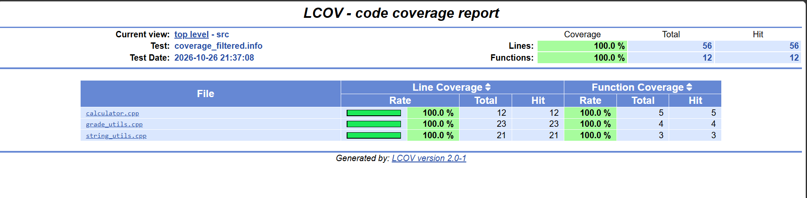

nano ../docs/parte5-cobertura.md
# Parte 8. Cobertura de código

## Objetivo

Medir qué partes del código fuente fueron ejecutadas durante las pruebas automatizadas, utilizando lcov y genhtml para identificar la cobertura obtenida.

## ¿Qué es la cobertura de código?

La cobertura de código es una métrica que permite identificar qué líneas, funciones o ramas de un programa fueron ejecutadas durante las pruebas automatizadas.

Esta información permite reconocer partes del código que todavía no han sido evaluadas y orientar el diseño de pruebas adicionales.

## Herramientas utilizadas

Se utilizaron las siguientes herramientas:

- CMake: configuración y compilación del proyecto.
- Google Test: ejecución de pruebas unitarias.
- lcov: recopilación de datos de cobertura.
- genhtml: generación del reporte de cobertura en formato HTML.

## Procedimiento

Primero, se configuró el proyecto con la opción de cobertura habilitada:

```bash
cmake -DENABLE_COVERAGE=ON ..
make
./run_tests
```

Posteriormente, se utilizó lcov para recopilar los datos de cobertura.

Durante el procedimiento inicial se presentó un error relacionado con archivos de Google Test y la recopilación de información de cobertura.

Para resolverlo, se limitó la recopilación a los archivos compilados de la biblioteca project_lib mediante el comando:

```bash
lcov --capture --directory CMakeFiles/project_lib.dir --output-file coverage.info
```

Después se filtró la información y se generó el reporte HTML:

```bash
lcov --remove coverage.info '/usr/*' '*/_deps/*' '*/tests/*' --output-file coverage_filtered.info
genhtml coverage_filtered.info --output-directory coverage_report
```

Finalmente, se consultaron los resultados mediante:

```bash
lcov --list coverage_filtered.info
```

## Resultados obtenidos

Después de implementar las pruebas del mini reto, se realizó una nueva medición de cobertura para incluir la función `is_valid_grade()`.

Los resultados definitivos fueron:

| Archivo | Líneas cubiertas | Funciones cubiertas |
|---|---|---|
| calculator.cpp | 100% (12/12) | 100% (5/5) |
| grade_utils.cpp | 100% (23/23) | 100% (4/4) |
| string_utils.cpp | 100% (21/21) | 100% (3/3) |
| Total | 100% (56/56) | 100% (12/12) |

La cobertura total alcanzó el 100% de las líneas y funciones instrumentadas.

La nueva medición incluyó las cuatro funciones de grade_utils.cpp, incorporando la función is_valid_grade() desarrollada durante el mini reto.

No se identificaron líneas ni funciones sin ejecutar. Sin embargo, la cobertura de ramas no fue medida, por lo que estos resultados no garantizan que se hayan probado todas las condiciones posibles del programa.


## Resultados obtenidos

Después de implementar las pruebas del mini reto, se realizó una nueva medición de cobertura para incluir la función `is_valid_grade()`.

Los resultados definitivos fueron:

| Archivo | Líneas cubiertas | Funciones cubiertas |
|---|---|---|
| calculator.cpp | 100% (12/12) | 100% (5/5) |
| grade_utils.cpp | 100% (23/23) | 100% (4/4) |
| string_utils.cpp | 100% (21/21) | 100% (3/3) |
| Total | 100% (56/56) | 100% (12/12) |

La cobertura total alcanzó el 100% de las líneas y funciones instrumentadas.

La nueva medición incluyó las cuatro funciones de grade_utils.cpp, incorporando la función is_valid_grade() desarrollada durante el mini reto.

No se identificaron líneas ni funciones sin ejecutar. Sin embargo, la cobertura de ramas no fue medida, por lo que estos resultados no garantizan que se hayan probado todas las condiciones posibles del programa.


## Análisis de resultados

### Archivo con mayor cobertura

Los tres archivos evaluados alcanzaron una cobertura de líneas del 100%, por lo que ninguno presentó un porcentaje superior a los demás.

### Archivo con menor cobertura

Ninguno de los archivos presentó una cobertura inferior. Los tres alcanzaron el mismo porcentaje de cobertura.

### Líneas o ramas no cubiertas

El reporte no identificó líneas ni funciones sin ejecutar en los archivos analizados.

Sin embargo, no se realizó una medición específica de cobertura de ramas. Por esta razón, el resultado no permite afirmar que todas las alternativas de las condiciones del programa hayan sido evaluadas.

### Pruebas adicionales propuestas

Aunque se alcanzó el 100% de cobertura de líneas y funciones, se pueden ampliar los escenarios evaluados mediante nuevas pruebas.

1. Comprobar que count_vowels("AEIOU") devuelva 5, para verificar explícitamente el reconocimiento de vocales mayúsculas.
2. Comprobar que divide(0, 5) devuelva 0, para evaluar una división cuyo dividendo sea cero.

Estas pruebas ampliarían la variedad de entradas verificadas, aunque no necesariamente aumentarían el porcentaje de cobertura de líneas, que ya alcanzó el 100%.

## Evidencia



## Preguntas de reflexión

### 1. ¿Qué significa tener 100% de cobertura?

Significa que todas las unidades de código consideradas por la métrica utilizada fueron ejecutadas durante las pruebas. En este caso, el 100% de cobertura de líneas indica que todas las líneas instrumentadas fueron ejecutadas.

### 2. ¿Tener 100% de cobertura garantiza que el programa no tiene errores?

No. Aunque todas las líneas hayan sido ejecutadas, pueden existir errores lógicos o comportamientos incorrectos que las pruebas no hayan detectado.

### 3. ¿Qué diferencia hay entre cobertura de líneas y cobertura de ramas?

La cobertura de líneas indica qué líneas del código fueron ejecutadas. La cobertura de ramas evalúa si se ejecutaron las distintas alternativas de las decisiones presentes en el programa.

### 4. ¿Por qué una línea ejecutada no necesariamente significa que fue bien probada?

Porque ejecutar una línea no garantiza que se haya comprobado correctamente su resultado ni que se hayan evaluado todas sus posibles condiciones de funcionamiento.

### 5. ¿Cómo puede ayudar la cobertura a mejorar las pruebas?

Permite identificar partes del programa que no han sido ejecutadas y orientar la implementación de nuevos casos de prueba. También ayuda a reconocer limitaciones en las verificaciones existentes.

