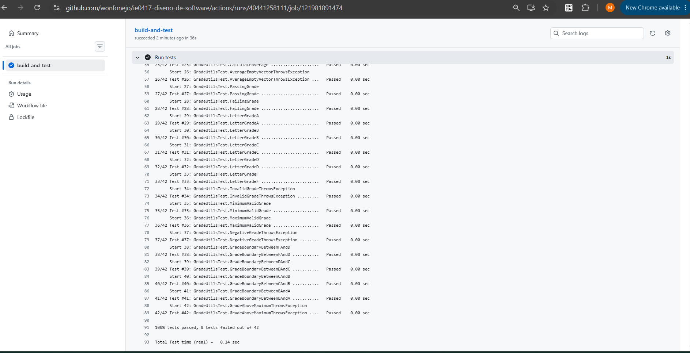
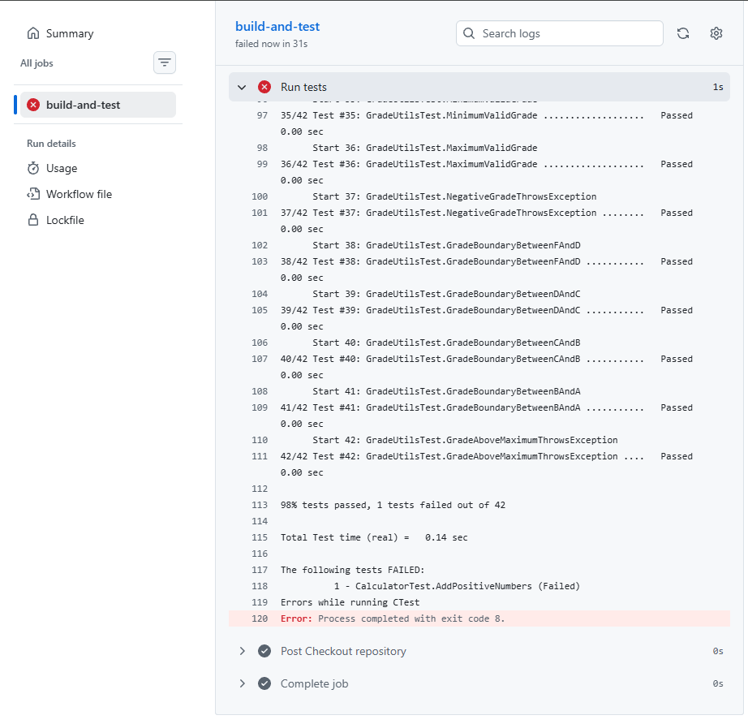
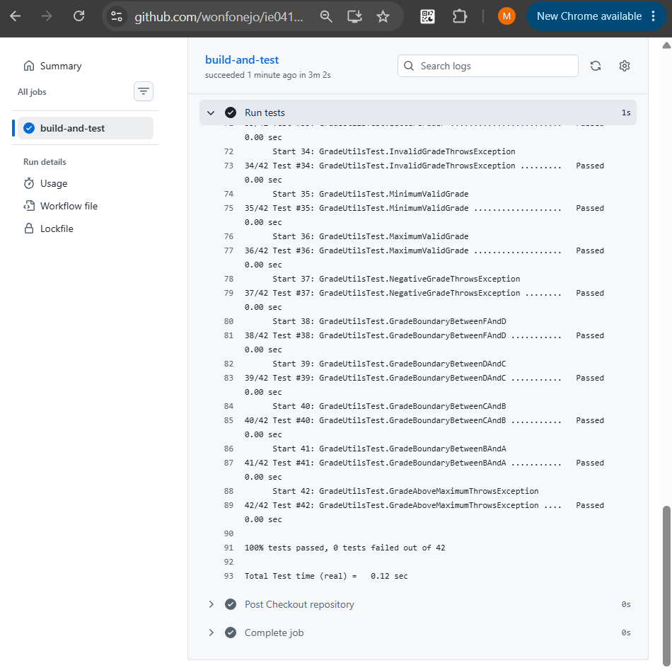

## Resultados de GitHub Actions

Se subió una copia del proyecto al repositorio de GitHub para ejecutar las pruebas mediante GitHub Actions.

Después de realizar el push a la rama main, se inició automáticamente el workflow C++ testing.

El proceso completó correctamente las etapas de instalación de dependencias, configuración con CMake, compilación y ejecución de pruebas.

Se verificó que las 42 pruebas automatizadas se ejecutaron correctamente.

## Evidencia de ejecución exitosa



## Parte 11. Fallo intencional en CI

### Objetivo

Comprobar que GitHub Actions puede detectar automáticamente una prueba fallida después de subir cambios al repositorio.

### Error introducido

Se modificó temporalmente la prueba AddPositiveNumbers del archivo tests/test_calculator.cpp.

Originalmente, la prueba verificaba que la suma de 2 y 3 produjera el resultado 5.

Se cambió intencionalmente el resultado esperado a 999:

```cpp
EXPECT_EQ(add(2, 3), 999);
```

### Resultado de la prueba local

Después de compilar y ejecutar la prueba, Google Test detectó una discrepancia entre el resultado esperado y el obtenido.

La prueba esperaba 999, pero la función devolvió 5.

### Resultado en GitHub Actions

Se realizó un commit con el error intencional y se subió a GitHub.

El workflow se ejecutó automáticamente y detectó el fallo durante la etapa de pruebas.

La ejecución fue marcada como fallida, demostrando que la integración continua permite detectar errores en los cambios enviados al repositorio.

### Evidencia del fallo



### Corrección

Se restauró el resultado esperado original:

```cpp
EXPECT_EQ(add(2, 3), 5);
```

Después de compilar y comprobar las pruebas localmente, se realizó un nuevo commit y se subió la corrección a GitHub.

La siguiente ejecución de GitHub Actions finalizó correctamente.

### Evidencia de la corrección



### Preguntas de reflexión

#### 1. ¿Por qué es útil ver una prueba fallar al menos una vez?

Porque permite comprobar que las pruebas realmente pueden detectar comportamientos incorrectos y producir información útil para identificar problemas.

#### 2. ¿Qué diferencia hay entre una prueba fallando localmente y una prueba fallando en CI?

Una prueba local se ejecuta en el entorno del desarrollador, mientras que una prueba en CI se ejecuta automáticamente en un entorno configurado para verificar los cambios enviados al repositorio.

#### 3. ¿Por qué no se debería dejar código con pruebas fallidas en la rama principal?

Porque indica que el proyecto no cumple con alguna de las verificaciones establecidas y podría afectar su funcionamiento o futuras modificaciones.

#### 4. ¿Qué aporta CI a la calidad del software?

Permite ejecutar verificaciones automatizadas después de integrar cambios y detectar posibles errores de forma temprana.
