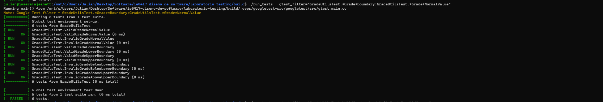

# Reflexión y mini reto de testing

## Parte 12. Mini reto de testing

### Objetivo

Implementar una función para verificar la validez de una calificación y diseñar pruebas automatizadas que comprueben su funcionamiento en casos normales, casos borde y valores inválidos.

### Función implementada

Se agregó la función `is_valid_grade()` en los archivos `include/grade_utils.h` y `src/grade_utils.cpp`.

La función recibe un número entero y devuelve `true` cuando la calificación se encuentra entre 0 y 100, incluyendo ambos límites. En caso contrario, devuelve `false`.

```cpp
bool is_valid_grade(int grade) {
    return grade >= 0 && grade <= 100;
}
```

### Casos de prueba diseñados

Se implementaron seis pruebas en el archivo `tests/test_grade_utils.cpp`.

| Prueba | Entrada | Resultado esperado | Tipo |
|---|---|---|---|
| ValidGradeNormalValue | 85 | true | Normal válido |
| InvalidGradeNormalValue | 150 | false | Inválido |
| ValidGradeLowerBoundary | 0 | true | Borde inferior |
| ValidGradeUpperBoundary | 100 | true | Borde superior |
| InvalidGradeBelowLowerBoundary | -1 | false | Debajo del límite |
| InvalidGradeAboveUpperBoundary | 101 | false | Encima del límite |

### Justificación de los casos

Los valores 85 y 150 permiten verificar el comportamiento de la función con una calificación válida y otra inválida.

Los valores 0 y 100 permiten comprobar que ambos extremos del intervalo válido se encuentran incluidos.

Los valores -1 y 101 permiten verificar que las calificaciones inmediatamente fuera de los límites sean rechazadas.

### Ejecución de las pruebas

Se utilizaron los siguientes comandos:

```bash
make
./run_tests
ctest --output-on-failure
```

Se agregaron seis pruebas nuevas y se ejecutaron un total de 48 pruebas automatizadas.

Las seis pruebas del mini reto se completaron correctamente.

### Evidencia




### Integración con GitHub Actions

Los cambios realizados durante el mini reto se subieron al repositorio de GitHub mediante los comandos `git add`, `git commit` y `git push`.

Posteriormente, se verificó la ejecución automática del workflow configurado en GitHub Actions. El proceso permitió compilar el proyecto y ejecutar las 48 pruebas implementadas, incluyendo las seis correspondientes a la función `is_valid_grade()`.

La ejecución finalizó correctamente, sin pruebas fallidas, confirmando que la nueva funcionalidad se integró al proyecto sin afectar las pruebas existentes.

### Preguntas de reflexión

#### 1. ¿Cuál fue el caso más obvio de probar?

Un valor válido como 85, porque se encuentra claramente dentro del intervalo permitido.

#### 2. ¿Cuál fue el caso borde más importante?

Los valores 0 y 100, porque permiten comprobar que los extremos del intervalo sean aceptados correctamente.

#### 3. ¿Qué error podría aparecer si no se prueban los valores 0 y 100?

Podría existir un error en las comparaciones que excluyera incorrectamente uno de los límites permitidos.

#### 4. ¿Qué diferencia hay entre probar 50 y probar -1, 0, 100 y 101?

El valor 50 comprueba un caso normal, mientras que los demás permiten verificar los límites exactos del intervalo y el rechazo de valores fuera de él.

#### 5. ¿Qué aprendió sobre diseñar pruebas?

Que es importante considerar diferentes tipos de entradas y no limitarse a los casos normales. Las pruebas de límites permiten identificar errores que podrían pasar desapercibidos durante el funcionamiento habitual.
